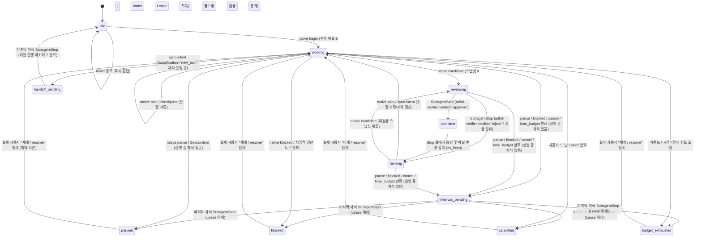
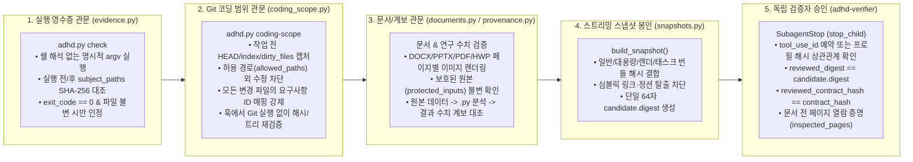
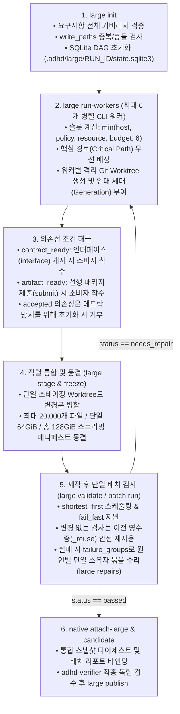

# ADHD — Autonomous Delegation Harness Director (v0.1.7)

> **Codex App 및 CLI 환경을 위한 로컬 자율 위임·검증 하네스 오케스트레이터**<br>
> 사용자의 기존 인증(`auth.json`), 모델 선택, 라우터, 플러그인 및 개인 설정(`config.toml`)을 침해하지 않으면서, **요구사항 기반 계획(Planning) → 범위가 제한된 위임(Bounded Delegation) → 실행 영수증 검증(Execution Receipts) → 독립 검증자 게이트(Independent Review Gate)**를 Codex 생명주기 훅(Lifecycle Hooks)으로 결합합니다.

| 항목 | 세부 사양 (코드베이스 실측 기준) |
| :--- | :--- |
| **패키지 버전** | `v0.1.7` ([adhd/\_\_init\_\_.py](adhd/__init__.py), 상태 스키마 `v2`, 설치 레코드 스키마 `v3`) |
| **런타임 요구사항** | Python `3.11+` (소스 설치 기준) / Windows x64 오프라인 설치기는 공식 `Python 3.13.16` 임베디드 런타임 내장 |
| **핵심 엔진 규모** | 총 **44개** Python 모듈 (`adhd.py`, `hook.py`, `adhd/*.py`) · **20,200 LOC** (순수 코어 코드 기준) |
| **회귀 테스트 스위트** | 총 **75개** 테스트 모듈 (`tests/test_*.py`) · **12,643 LOC** (550개 이상 단위·서브프로세스·패키징 검증) |
| **에이전트 역할(Roles)** | 3종 모델 계층(`gpt-6-sol`, `gpt-6-luna`, `gpt-6-astra`) 기반 **6개 고정 역할** (`native/agents/*.toml`) |
| **내장 스킬 & MCP** | 코어/워크플로 스킬 **13종** (`skills/adhd*`) + 공개 번들 스킬 **50종** (`bundled/skills/`) + MCP 레시피 **16종** (`config/mcp-selection.json`) |
| **내장 의존성(Vendored)** | `filelock` v3.29.0 (Unlicense), `tomlkit` (MIT) 오프라인 순수 Python 내장 ([adhd/dependencies.py](adhd/dependencies.py)) |
| **라이선스** | `Apache-2.0` ([LICENSE](LICENSE)) · 상위 Raibit Harness v1.2 계보 `MIT` 고지 보존 ([LICENSE-RAIBIT-MIT](LICENSE-RAIBIT-MIT)) |

> 구성 흐름: Codex lifecycle hooks → ADHD native controller/task runner → 검증된 결과물과 독립 검토.

## 1. 프로젝트 개요 및 핵심 설계 철학

**ADHD (Autonomous Delegation Harness Director)**는 AI 에이전트가 복잡한 코딩, 연구, 문서 작성, 데이터 분석, 게임 개발 과업을 수행할 때 발생하는 **조기 완료 선언(Self-Declared Completion), 요구사항 누락, 무분별한 파일 수정, 무한 실패 루프, 문맥 비대화(Context Bloat)** 문제를 시스템 계층에서 해결하기 위해 설계된 로컬 오케스트레이션 하네스입니다.

코드베이스 전반([hook.py](hook.py), [adhd/native.py](adhd/native.py), [adhd/large\_tasks.py](adhd/large_tasks.py), [adhd/coding\_scope.py](adhd/coding_scope.py))을 관통하는 **5대 핵심 설계 원칙(Architectural Invariants)**은 다음과 같습니다:

1. **호스트 훅(Host Hook)과 샌드박스 CLI의 엄격한 권한 분리 (Trust-Boundary Separation)**
   * Codex 호스트가 실행하는 [hook.py](hook.py)는 `stdin`으로 최대 `180,000 bytes`의 이벤트 JSON만 읽고 `stdout`으로 제어 JSON만 출력하며, **절대로 모델이 제공한 쉘 명령이나 Git 서브프로세스를 직접 실행하지 않습니다.**
   * 정본 상태(Canonical State)는 워크스페이스 외부인 `$CODEX_HOME/adhd/native/<SESSION_KEY>/state.json`에 격리 보관되며, 워크스페이스 내부의 `.adhd/bridge/<SESSION_KEY>/view.json`은 읽기 전용 투영본(Read-Only Projection)으로만 노출됩니다.
2. **단일 루프 소유자 및 단일 작성자 불변성 (Single Owner & Single-Writer Invariant)**
   * 하나의 세션에서는 오직 하나의 실행 소유자(ADHD, OMX, 또는 LazyCodex)만 루프를 제어합니다.
   * App 세션에서는 동시에 단 하나의 구현 자식(`adhd-implementer`)만 쓰기 권한을 가지며([adhd/leases.py](adhd/leases.py)), 대규모 병렬 작업(`large`)은 격리된 Git Worktree와 세대 번호(Lease Generation)가 부여된 최대 6개의 CLI 워커 프로세스로만 실행됩니다.
3. **무음 모델 다운그레이드 금지 및 역할별 추론 강도 고정 (Pinned Role Hierarchy)**
   * 계획·통합·구현·검증은 `gpt-6-sol`(`effort="max"`), 탐색·경량 추출은 `gpt-6-luna`(`effort="max"`, 선택적 `"low"` 허용), 고난도 설계 자문은 `gpt-6-astra`(`effort="low"`, 과업당 최대 1회)로 고정되며, 계정/라우터 오류 시 임의로 하위 모델로 대체(Silent Fallback)하지 않습니다([adhd/models.py](adhd/models.py)).
4. **관측된 실행 영수증 기반 진전 판정 (Evidence-Bound Progress)**
   * 단순 텍스트 요약이나 타임스탬프 변경은 진전(Progress)으로 인정되지 않습니다. 오직 [adhd/evidence.py](adhd/evidence.py)가 기록한 **입력 파일 해시 고정 실행 영수증(`receipt.json`)**, 통과한 요구사항 증가, 실패 테스트 감소, 또는 실제 타깃 아티팩트 해시 변경만이 정체 카운터(`stagnation`)를 초기화합니다.
5. **독립 검증자 게이트 통과 필수 (Mandatory Independent Acceptance)**
   * 작성자(Parent Director 또는 `adhd-implementer`)는 자신의 결과물을 스스로 완료(`complete`) 처리할 수 없습니다. 모든 후보(`candidate`) 스냅샷은 읽기 전용 샌드박스에서 실행되는 독립 에이전트 **`adhd-verifier`**가 원본 프롬프트(`prompts`), 계약 해시(`contract_hash`), 후보 다이제스트(`candidate.digest`), 실행 영수증을 직접 대조하여 `{"verdict": "approve"}`를 반환했을 때만 `SubagentStop` 훅에서 최종 완료로 전이됩니다.

## 2. 전체 시스템 아키텍처 및 데이터 흐름

아래 다이어그램은 Codex 호스트(App/CLI), `hook.py` 이벤트 디스패처, 비대칭 브리지(`inbox`/`outbox`/`view.json`), 6대 에이전트 역할, 그리고 5개 로컬 스토리지/인덱스 엔진 간의 전체 구조와 제어 흐름을 보여줍니다.

```mermaid
flowchart TB
    subgraph Host["Codex App / CLI Host Boundary (Trusted)"]
        Events["9 Codex Hook Events<br/>(SessionStart, UserPromptSubmit, PreToolUse,<br/>PostToolUse, SubagentStart/Stop, PostCompact, Stop, SessionEnd)"]
        HookPy["hook.py<br/>(180KB Stdin Cap, HookDiagnostics,<br/>Zero Command Execution)"]
        NativeSM["adhd/native.py<br/>(Host State Machine & Gate Controller)"]
        CanonicalState[("$CODEX_HOME/adhd/native/SESSION/<br/>state.json + ledger.jsonl + FileLock")]
    end

    subgraph Bridge["Workspace Bridge (.adhd/bridge/SESSION/)"]
        Inbox["inbox/&lt;32-hex&gt;.json<br/>(Queued CLI Requests)"]
        Outbox["outbox/&lt;32-hex&gt;.json<br/>(Committed Receipts)"]
        ViewJson["view.json &amp; context-status.md<br/>(Read-Only State Projection)"]
        Packets["packets/&lt;agent_hash&gt;.json<br/>(Subagent Context Packets)"]
    end

    subgraph Sandbox["Workspace Sandbox &amp; CLI Tools (adhd.py)"]
        Director["Parent Director Agent (Sol / max)<br/>Request Routing &amp; Orchestration"]
        CLI["adhd.py CLI Entrypoint<br/>(native, check, coding-scope, large, batch,<br/>context, wiki, memory, objects, doc, provenance)"]
        Subagents["Pinned Native Subagents (native/agents/*.toml)<br/>• adhd-planner (Sol/max, RO)<br/>• adhd-scout (Luna/max|low, RO)<br/>• adhd-light (Luna/max|low, RO)<br/>• adhd-architect (Astra/low, RO, <=1 call)<br/>• adhd-implementer (Sol/max, Single Writer)<br/>• adhd-verifier (Sol/max, Independent Gate)"]
    end

    subgraph Engines["Local Verification, DAG &amp; Storage Engines"]
        Gates["Verification Gates<br/>• evidence.py (Execution Receipts)<br/>• coding_scope.py (Git Scope Audit)<br/>• documents.py (Page Render Check)<br/>• provenance.py (Claim Lineage)"]
        LargeDAG["Large-Task &amp; Batch Engine<br/>• large_tasks.py (SQLite DAG)<br/>• large_execution.py (<=6 CLI Workers)<br/>• validation_batch.py (Central Batch)"]
        Storage["Context, Memory &amp; CAS Storage<br/>• context_index.py (AST SQLite Index)<br/>• memory.py (FTS5 + KO Bigram + RRF)<br/>• obsidian_index.py (Vault SQLite Index)<br/>• immutable_store.py &amp; immutable_gc.py"]
    end

    Events --> HookPy --> NativeSM
    NativeSM <--> CanonicalState
    NativeSM -->|Export Projection| ViewJson
    NativeSM -->|Write Task Packet| Packets
    NativeSM -->|Read &amp; Validate| Inbox
    NativeSM -->|Write Ack| Outbox

    ViewJson -->|Read Status| Director
    Director -->|Invoke Tool| CLI
    CLI -->|submit_request()| Inbox
    Outbox -->|Read Ack| Director
    Director -->|Spawn Role| Subagents
    Packets -->|Read Scoped Brief| Subagents
    Subagents -->|SubagentStart / Stop| Events

    CLI --> Gates
    CLI --> LargeDAG
    CLI --> Storage
    Gates -->|Verify Hashes &amp; Receipts| NativeSM
```

### 비대칭 훅-샌드박스 IPC 프로토콜 (Inbox / Outbox / View 메커니즘)

샌드박스 내부에서 실행되는 에이전트는 호스트의 정본 `state.json`을 직접 수정할 수 없습니다. 대신 [adhd/native.py](adhd/native.py)의 `submit_request()`와 `process_inbox()`가 다음과 같은 **2단계 비동기 커밋 프로토콜**로 상태 전이를 수행합니다:

```mermaid
sequenceDiagram
    autonumber
    participant Agent as Codex Agent (Sandbox)
    participant CLI as adhd.py native &lt;OP&gt;
    participant Bridge as .adhd/bridge/SESSION/
    participant Hook as hook.py (PostToolUse / Stop)
    participant State as $CODEX_HOME/.../state.json

    Agent->>CLI: python adhd.py native begin/plan/checkpoint/candidate ...
    CLI->>Bridge: Read view.json (Check reader version &amp; active contract)
    CLI->>Bridge: Write inbox/&lt;32-hex-id&gt;.json
    CLI-->>Agent: Return {"status": "queued", "request_id": "..."} (Exit 0)
    Note over Agent,Hook: Shell tool finishes; Codex Host immediately triggers PostToolUse hook
    Hook->>State: Acquire FileLock(state.lock) &amp; Load state.json
    Hook->>Bridge: process_inbox() reads up to 8 sorted inbox/*.json files
    Hook->>Hook: apply_request(state, op, payload) validates contract, hashes &amp; receipts
    alt Validation Passed
        Hook->>State: Commit updated state.json &amp; Append ledger.jsonl
        Hook->>Bridge: Export updated view.json &amp; .adhd/context-status.md
        Hook->>Bridge: Write outbox/&lt;id&gt;.json ({"ok": true, "status": ...})
        Hook->>Bridge: Move inbox/&lt;id&gt;.json -> processed/&lt;id&gt;.json
    else Validation Failed (ValueError / OSError)
        Hook->>State: Rollback state in-memory to pre-request snapshot
        Hook->>Bridge: Write outbox/&lt;id&gt;.json ({"ok": false, "message": error})
        Hook->>Bridge: Move inbox/&lt;id&gt;.json -> processed/&lt;id&gt;.json
    end
    Hook-->>Agent: Emit hookSpecificOutput.additionalContext (Ack + Loop Guidance)
```

## 3. 디렉토리 구조 및 44개 코어 모듈 상세 분석

저장소는 실행 엔트리포인트(`adhd.py`, `hook.py`), 코어 패키지(`adhd/`), 고정 에이전트 프로필(`native/agents/`), 하네스 및 번들 스킬(`skills/`, `bundled/skills/`), 스키마(`schemas/`), 설정 카탈로그(`config/`), 빌드/설치 도구(`build/`), 벤치마크 스크립트(`scripts/`), 회귀 테스트(`tests/`)로 구성됩니다.

```text
ADHD/
├── adhd.py                         # CLI 메인 엔트리포인트 (adhd.cli.main 호출)
├── hook.py                         # Codex 호스트 훅 엔트리포인트 (stdin JSON -> adhd.native.handle_event)
├── install.ps1 / install.sh        # Windows PowerShell 및 macOS/Linux 원클릭 업그레이드 스크립트
├── requirements-documents.txt      # 문서 렌더링/편집 선택 의존성 (pypdf, python-docx, python-pptx 등)
├── adhd/                           # 핵심 오케스트레이션 패키지 (42개 모듈, 20,159 LOC)
│   ├── native.py                   # 호스트 상태 머신, 9대 훅 핸들러, 후보/검증자 게이트 (2,306 LOC)
│   ├── large_tasks.py              # 대규모 작업 SQLite DAG 큐, 임대 세대, Git Worktree 스테이징 (1,395 LOC)
│   ├── native_install.py           # 트랜잭션 기반 오버레이 설치기, 백업 검증, 원자적 롤백 (835 LOC)
│   ├── immutable_gc.py             # CAS 불변 저장소 닫힌 세계(Closed-World) 가비지 컬렉터 (753 LOC)
│   ├── experience.py               # 선별적 경험 기록 후보 생성, 피드백 매핑, 원장(Ledger) 복구 (695 LOC)
│   ├── builtin.py                  # 50개 번들 스킬 배포 및 16개 MCP 준비도/프로브 검증 (675 LOC)
│   ├── validation_batch.py         # 중앙 일괄 검사 배치, 입력 해시 재사용, 실패 그룹핑 (630 LOC)
│   ├── memory.py                   # SQLite FTS5 + 한국어 문자 바이그램 + RRF 로컬 메모리 (559 LOC)
│   ├── immutable_store.py          # SHA-256 내용 주소화(CAS) 완료 증거 저장소 및 ZIP 내보내기 (548 LOC)
│   ├── runner.py                   # 프로세스 트리 실행/종료, 리소스 락, 레거시 루프 러너 (482 LOC)
│   ├── context_index.py            # Python AST 심볼 추출 및 증분 SQLite 코드 인덱서 (460 LOC)
│   ├── obsidian.py                 # 워크스페이스별 범위 제한 Obsidian 볼트 문맥 조회기 (442 LOC)
│   ├── core.py                     # 원자적 파일 I/O, SHA-256 해싱, 경로 탈출 방지, 공통 유틸 (433 LOC)
│   ├── obsidian_index.py           # Obsidian 프론트매터 파서, 별칭/리비전/툼스톤 SQLite 인덱스 (406 LOC)
│   ├── extensions.py               # 외부 확장 스테이징, 불변 로컬 핀 검증, 프로브 실행 (405 LOC)
│   ├── evidence.py                 # 로컬 프로세스 실행 영수증(Receipt) 생성 및 호스트 툴 관측 (400 LOC)
│   ├── snapshot_reader.py          # 불변 커밋/더티 스냅샷 격리 읽기 및 작성자 전환 검증 (399 LOC)
│   ├── experience_procedures.py    # 성공 사례 및 컨트롤러 검증 절차(Procedure) 제안/롤백 (389 LOC)
│   ├── context_search.py           # 코드·메모리·위키 통합 위치 탐색 및 리비전 바인딩 읽기 (341 LOC)
│   ├── resource_metrics.py         # 프로세스 트리 CPU/메모리/디스크 샘플링 및 사후 관측 (330 LOC)
│   ├── documents.py                # Office/PDF/HWP/HWPX 문서 검사, 텍스트 편집, 페이지 렌더링 (328 LOC)
│   ├── trial_registry.py           # All-Start 실험 레지스트리 및 사전 등록 롤아웃 게이트 (316 LOC)
│   ├── context_session.py          # 액터/에폭별 문맥 전달 원장 및 상태 마크다운 내보내기 (304 LOC)
│   ├── experience_storage.py       # 위키/증거 저장공간 인벤토리, 참조 감사, 아카이브 복원 (298 LOC)
│   ├── cli.py / extra_cli.py       # 23개 최상위 CLI 서브커맨드 파서 및 디스패처 (570 LOC 합산)
│   ├── coding_scope.py             # Git 변경 범위 캡처/감사/검증 및 훅 전용 무-Git 검증 (257 LOC)
│   ├── fts_migration.py            # 메모리 FTS5 외부 콘텐츠(External Content) 무중단 마이그레이션 (254 LOC)
│   ├── snapshots.py                # 일반/대용량 아티팩트 및 렌더 번들 스트리밍 스냅샷 (247 LOC)
│   ├── loop_guard.py               # 실패 핑거프린트 링(12슬롯), 비밀값 마스킹, 정체 조향 (238 LOC)
│   ├── storage.py                  # 미참조 구버전 관리 릴리스 스캔 및 안전한 프루닝 (238 LOC)
│   ├── source_cache.py             # 핀 고정된 로컬 Git 커밋/경로 스냅샷 재사용 캐시 (217 LOC)
│   ├── large_execution.py          # 격리된 Codex CLI 워커 프로세스 실행 및 소유 경로 커밋 (207 LOC)
│   ├── provenance.py               # 연구 수치 주장과 원본 데이터·분석 스크립트 계보 검증 (198 LOC)
│   ├── install.py                  # 레거시 설치/제거 및 트리 해시 검증 (196 LOC)
│   ├── large_cli.py                # large 및 batch 전용 CLI 파서와 로컬 퍼블리시 (187 LOC)
│   ├── execution_decisions.py      # 권한 있는 액션 등록, 거절 분류, 폴링 대기 시간 결정 (185 LOC)
│   ├── change_journal.py           # 소유자 범위 조건부 config.toml 변경 및 저널 복구 (167 LOC)
│   ├── intent.py                   # 활성 계약에 대한 버전 바인딩 증분 패치(add/replace/retract) (163 LOC)
│   ├── host_capabilities.py        # 훅 이벤트 정규화, 호스트 기능 관측, 스레드 목표(/goal) 추적 (161 LOC)
│   ├── gates.py                    # 계획 구조, 학습 확인(Learning Check), 문서 계약 검증 게이트 (144 LOC)
│   ├── run_metrics.py              # 관측된 실행 토큰/비용 집계 및 쌍대 실험 비교 (134 LOC)
│   ├── recovery.py                 # 11종 실패 카테고리 자동 분류 및 복구 진단 생성 (132 LOC)
│   ├── request_routing.py          # 초기 유휴 요청 4단계 경로 분류기 (direct/simple/inspect/deep) (129 LOC)
│   ├── delivery_policy.py          # 보존 조건, 마감 시간(Deadline) 경보, 릴리스/라이브 배포 검증 (111 LOC)
│   ├── large_native.py             # 네이티브 훅 내부의 읽기 전용 대규모 작업 승인 어댑터 (110 LOC)
│   ├── evaluation.py               # 프로필별 대표 개인 과업 픽스처 반복 평가기 (100 LOC)
│   ├── models.py                   # Sol/Luna/Astra 모델 정책, 역할 라우팅, 추론 강도 오버라이드 (96 LOC)
│   ├── large_prompts.py            # 원문 발췌를 보존하는 경량 영어 워커 위임 패킷 생성기 (90 LOC)
│   ├── immutable_policy.py         # 워크스페이스 소유 immutable-policy.json 권한 검증기 (89 LOC)
│   ├── leases.py                   # 워크스페이스 단일 작성자 임대(Lease) 획득/갱신/해제 (81 LOC)
│   ├── windows_setup.py            # Windows 번들 인스톨러 추출 후 오프라인 설치 엔트리 (67 LOC)
│   ├── skill_router.py             # 외부 skill_wiki.py 우선 라우팅 및 로컬 결정론적 폴백 (66 LOC)
│   ├── wiki.py                     # ZIP 아카이브 안전 스캔 및 선별적 마크다운 인제스천 (61 LOC)
│   ├── maintenance_budget.py       # 유지보수 작업당 동기식 CPU(10s) 및 I/O(512MiB) 예산 강제 (58 LOC)
│   ├── review_calibration.py       # 고정 보정 케이스 대비 독립 검증자 판정 정확도 측정 (47 LOC)
│   ├── completed_archive.py        # 완료된 네이티브 실행의 텍스트 증거 명시적 캡처 (34 LOC)
│   ├── time_budget.py              # 선택적 벽시계 시간 제한(Wall-Time Limit) 검증기 (20 LOC)
│   ├── obsidian_assets/            # Obsidian 브리지(bridge.py), 로그 코덱/아카이브, 템플릿 5종, Base 2종
│   └── vendor/smolagents_context.py# 긴 출력 중간 절단(Truncate) 유틸리티
├── native/agents/                  # 6대 네이티브 에이전트 역할 TOML 정의 (planner, scout, light, architect, implementer, verifier)
├── skills/                         # 13개 ADHD 전용 스킬 (adhd, adhd-native, adhd-goal, adhd-shape 등)
├── bundled/skills/                 # 50개 라이선스 검증 공개 스킬 트리 (OpenAI 30개 + K-Dense 20개)
├── config/                         # builtin-skills.json, mcp-selection.json, 프로필/정책 예제
├── schemas/                        # JSON 스키마 6종 (plan, work, review, large-task, native-delivery, wiki-packet)
├── build/                          # 배포 패키지 빌더(package_adhd.py) 및 Windows C# 런처(launcher.cs)
├── scripts/                        # 훅, 범위 인벤토리, 배달 효율성, 시간 예산, Obsidian 벤치마크 스크립트 11종
├── docs/                           # 설계 문서 9종, 릴리스 노트(0.1.4~0.1.7), 실측 벤치마크 JSON
├── third_party/                    # Vendored 패키지(filelock, tomlkit, spec-kit, superpowers) 및 라이선스
└── tests/                          # 75개 통합·회귀 테스트 모듈 (12,643 LOC)
```

### 서브시스템별 코드 규모 및 핵심 책임 요약표

| 서브시스템 분류 | 포함 모듈 | 코드 라인 수 (LOC) | 비중 (%) | 핵심 엔지니어링 책임 |
| :--- | :--- | ---: | ---: | :--- |
| **1. 네이티브 상태 머신 & 훅 IPC** | `native.py`, `hook.py`, `intent.py`, `loop_guard.py`, `recovery.py`, `request_routing.py`, `host_capabilities.py`, `execution_decisions.py`, `delivery_policy.py`, `leases.py`, `time_budget.py`, `hook_diagnostics.py` | 3,926 | 19.4% | 9대 Codex 훅 이벤트 처리, `inbox`/`outbox` 비동기 상태 전이, 루프 정체 감지 및 전략 조향, 단일 작성자 임대 제어 |
| **2. Obsidian 볼트 & 경험 엔진** | `obsidian.py`, `obsidian_index.py`, `experience.py`, `experience_procedures.py`, `experience_storage.py`, `wiki.py`, `obsidian_assets/*` | 3,159 | 15.6% | Markdown 위키 프론트매터 검증, SQLite 캐시 인덱싱, 선별적 경험/피드백 원장 관리, 컨트롤러 검증 절차 채택, 증거 아카이브 |
| **3. 대규모 작업 DAG & 일괄 검증** | `large_tasks.py`, `validation_batch.py`, `snapshots.py`, `large_execution.py`, `large_cli.py`, `large_native.py`, `large_prompts.py` | 2,876 | 14.2% | SQLite 기반 작업 DAG 스케줄링, 최대 6개 격리 Git Worktree CLI 워커 실행, 직렬 스테이징, 중앙 검사 배치 및 입력 해시 재사용 |
| **4. CLI, 모델 라우팅 & 메트릭** | `cli.py`, `extra_cli.py`, `core.py`, `runner.py`, `models.py`, `resource_metrics.py`, `trial_registry.py`, `run_metrics.py`, `evaluation.py`, `skill_router.py`, `maintenance_budget.py` | 2,560 | 12.7% | 23개 CLI 서브커맨드 제공, Sol/Luna/Astra 모델 핀 고정, 프로세스 트리 자원 측정, 실험 레지스트리 및 유지보수 예산 제한 |
| **5. 설치기, 번들 스킬 & MCP** | `native_install.py`, `builtin.py`, `extensions.py`, `install.py`, `change_journal.py`, `windows_setup.py`, `dependencies.py` | 2,345 | 11.6% | `$CODEX_HOME` 트랜잭션 설치 및 원자적 롤백, 50개 공개 스킬 배포, 16개 MCP 상태/읽기 프로브 검증, Windows 오프라인 셋업 |
| **6. 문맥 인덱싱 & FTS5 메모리** | `context_index.py`, `memory.py`, `context_search.py`, `context_session.py`, `fts_migration.py`, `vendor/smolagents_context.py` | 1,924 | 9.5% | Python AST 심볼 인덱싱, 한국어 문자 바이그램 + SQLite FTS5 + RRF 하이브리드 메모리 검색, 액터/에폭별 문맥 전달 원장 |
| **7. 불변 CAS 저장소 & 가비지 컬렉션** | `immutable_store.py`, `immutable_gc.py`, `storage.py`, `source_cache.py`, `immutable_policy.py`, `completed_archive.py` | 1,882 | 9.3% | 완료된 실행 증거의 SHA-256 CAS 보관, 정책 기반 접근 제어, 닫힌 세계(Closed-World) 참조 클로저 검증 후 미참조 객체/릴리스 정리 |
| **8. 검증 게이트, 문서 & 계보** | `evidence.py`, `documents.py`, `coding_scope.py`, `provenance.py`, `gates.py`, `review_calibration.py` | 1,528 | 7.6% | 실행 영수증(`receipt.json`) 발급, Git 변경 범위 감사, Office/PDF/HWP 페이지 렌더링 검증, 연구 수치 계보(Lineage) 검증 |
| **합계 (Core Python)** | **총 44개 파이썬 소스 파일** | **20,200** | **100.0%** | **75개 테스트 파일(`12,643 LOC`)과 1:0.63 비율로 맞물려 검증됨** |

## 4. 코드 기반 7대 핵심 동작 원리 심층 분석

### 원리 1: 9대 생명주기 훅(Lifecycle Hooks) 디스패치 및 출력 예산 제어

설치기([adhd/native\_install.py](adhd/native_install.py) L481–490)는 `$CODEX_HOME/hooks.json`에 9개의 훅 그룹을 등록합니다. 모든 훅은 [hook.py](hook.py)를 호출하며, 내부적으로 [adhd/native.py](adhd/native.py)의 `handle_event()`가 세션별 파일 락(`$CODEX_HOME/adhd/native/<SESSION>/state.lock`)을 획득한 뒤 이벤트를 처리합니다.

| 훅 이벤트 이름 | 매처(Matcher) 조건 | 타임아웃 | 문맥 한도 (`additionalContextLimit`) | `adhd/native.py` 내부 동작 및 보안 불변성 |
| :--- | :--- | :---: | :---: | :--- |
| **`SessionStart`** | 전체 세션 시작 (`startup`, `resume`, `compact`, `clear`, `fork`) | 20s | `1200` | `session_helper_profiles`, `session_verifier_profile`, `session_reader`의 SHA-256 해시를 기록하고, 압축/재개 시 현재 목표·프로필·미충족 기준을 복원 |
| **`UserPromptSubmit`** | 사용자 프롬프트 제출 시 | 20s | `1200` | 중단(`그만`/`stop`)·재개(`재개`/`resume`)·목표(`/goal`, `$adhd-goal`) 명령을 감지하고, `classify_request()`로 초기 라우팅 수행. 동일한 `guidance_signature` 반복 시 빈 문맥 반환 |
| **`PreToolUse`** | `Agent\|spawn_agent` | 20s | `1200` | 시간 예산 만료 여부, 이전에 거절된 동일 호스트 액션 재시도 차단(`matched_host_action`), `spawn_guard()`를 통한 에이전트 역할·모델·쿼터·단일 작성자 규칙 강제 |
| **`PostToolUse`** | `Bash\|exec\|wait\|exec_command\|write_stdin\|apply_patch\|update_plan\|mcp__.*` | 20s | `1200` | 호스트 도구 결과 관측(`observe_host_tool`), 브리지 `inbox/*.json` 최대 8개 처리(`process_inbox`), `observe_tool_loop()`를 통한 동일 명령 반복 실패 감지 |
| **`SubagentStart`** | 서브에이전트 시작 시 | 20s | `1200` | `start_child()`: `tool_use_id` 예약 또는 `session_verifier_profile` 해시 대조로 자식 상관관계(`correlated`) 입증, `.adhd/bridge/SESSION/packets/`에 원문 발췌가 담긴 작업 패킷 생성 |
| **`SubagentStop`** | 서브에이전트 종료 시 | 20s | 없음 | `stop_child()`: 자식 실행 완료 처리, 인터럽트/핸드오프 대기 중이던 마지막 자식 종료 시 임대 해제, **`adhd-verifier`인 경우 엄격한 JSON 판정문 검증 후 `complete` 또는 `revising` 전이** |
| **`PostCompact`** | 문맥 압축 직후 | 20s | 없음 | `view_hint_sig`를 초기화하고 현재 상태 요약을 복원하여 압축 후 문맥 유실 방지 |
| **`Stop`** | 턴 종료 시도 시 | 20s | 없음 | 미처리 `inbox` 반영, 승인 후 파일 임의 수정 감지(`is_fresh` 실패 시 `revising` 강등), 활성 작업 중이면 라운드/정체 업데이트 후 `{"decision": "block", "reason": "[ADHD_CONTINUE:...]"}` 반환하여 루프 지속 |
| **`SessionEnd`** | 세션 종료 시 (`Interrupt` 포함) | 3s | 없음 | 활성 실행 중이면 `end_after_children(state, 'paused')`를 호출하여 실행 중인 자식이 모두 끝날 때까지 작성자 임대를 보호한 채 안전하게 일시 정지 |

* **1,200자 필수 필드 우선 보존 알고리즘 (`context()` L1966–2073)**: 문맥 안내 문자열을 생성할 때 `ADHD Status=...`, `SESSION=...; view=...`, `Next: ...`, 시간 예산 안내 등 **필수 복구 필드(`required`)를 먼저 배치**하고, 남은 글자 수(`1200 - len(text) - 1`) 안에만 부가 설명을 넣습니다. 긴 워크스페이스 경로나 목표 텍스트 때문에 중간의 `Next` 액션이 잘려 나가는 현상을 원천 방지합니다([docs/hook-followup-fixes.md](docs/hook-followup-fixes.md)).

### 원리 2: 초기 요청 라우팅 및 네이티브 상태 머신 전이

유휴(`idle`) 상태에서 사용자 프롬프트가 입력되면 [adhd/request\_routing.py](adhd/request_routing.py)의 `classify_request()`가 정규식 및 문맥 규칙을 통해 4가지 초기 경로로 분류합니다. 이를 통해 사소한 질문에 불필요한 계획·검증 루프를 띄우는 오버헤드를 제거합니다.

| 라우팅 경로 (`path`) | 판정 조건 (`adhd/request_routing.py`) | 권장 프로필 | 네이티브 컨트롤러 후속 동작 |
| :--- | :--- | :---: | :--- |
| **`direct`** | 인사말(`_GREETING`), 상태 질문(`_STATUS`), 외부 파일 참조 없는 순수 번역(`_TRANSLATION`), 단일 문장/단어 오타 수정(`_TYPO` + `_ISOLATED`), 저장소 참조 없는 일반 개념 설명(`_EXPLANATION` without `_REPO_REFERENCE`) | `simple` | **`native begin` 생략**: 내구성 계획이나 독립 검증 루프 없이 즉시 답변 (작업 범위 확대 시 `begin`으로 승격 가능) |
| **`simple`** | 단일 파일·함수·테스트에 국한된(`_BOUNDED`) 소규모 수정 액션(`_SMALL_ACTION`) | `simple` | `native begin --profile simple`: 계획서(`plan`) 선택 사항, 직접 수정 또는 최대 1개 작업 자식 위임, **최종 독립 검증(`adhd-verifier`)은 필수** |
| **`inspect`** | 범위가 불명확한 액션, 저장소 의존 질문(`_REPO_REFERENCE`), 민감 키워드(`_SENSITIVE`: DB, 인증, 결제, 삭제, 배포, 보안 등), 후속 액션이 결합된 번역/설명 | `standard` | 관련 파일과 문맥을 먼저 짧게 탐색한 뒤, 실질적 작업이면 `native begin` (기본 `standard`: 요구사항 커버리지 계획 + 자동 검사 + 독립 검증) 실행 |
| **`deep`** | 아키텍처 개편, 마이그레이션, 연구, 운영 배포, 엔드투엔드 시스템, 보안 감사(`_DEEP`) | `deep` | `native begin --profile deep`: 대안(`alternatives`)·위험(`risks`)·사전점검(`preflight`)을 포함한 심층 계획 필수 + **모든 타깃 아티팩트를 커버하는 최신 실행 영수증(`deep_evidence`) 및 심층 리뷰 필수** |

* **짧은 승인 상속 (`is_brief_approval`)**: 사용자가 `"ㅇㅇ 그렇게 해줘"`, `"진행해줘"`, `"go ahead"`처럼 짧은 승인만 입력하면 직전의 실질적 요청(`is_substantive_request_source`)의 라우팅 경로와 본문을 `effective_prompt`로 자동 상속합니다.
* **활성 계약 중 사용자 개입 동기화 (`sync-intent` & [adhd/intent.py](adhd/intent.py))**: 작업 진행 중에 사용자가 새 메시지를 보내면 `pending_turn_ids`에 등록되어 최종 리뷰가 보류됩니다. 에이전트는 해당 턴을 `no_change`(단순 상태 질문), `amend`(기존 계약의 `criteria`, `artifacts`, `documents`, `protected_inputs` 증분 수정 및 실행 중인 자식에게 `pending_context_deltas` 전파), 또는 `new_task`(기존 실행 아카이브 후 신규 계약 준비)로 명시적 분류해야 합니다.



### 원리 3: 3계층 모델 고정(Pinning) 및 6대 에이전트 역할 거버넌스

[adhd/models.py](adhd/models.py)와 [native/agents/\*.toml](native/agents/)은 에이전트의 역할을 6가지로 분리하고, 각 역할에 최적화된 모델과 추론 강도(`model_reasoning_effort`), 샌드박스 권한(`sandbox_mode`)을 엄격히 고정합니다.

| 에이전트 역할 (`ROLES`) | 정의 파일 | 고정 모델 (`MODELS`) | 기본 추론 강도 | `role_effort` 오버라이드 허용 | 샌드박스 모드 | 핵심 임무 및 `spawn_guard()` 제약 조건 |
| :--- | :--- | :---: | :---: | :---: | :---: | :--- |
| **`adhd-planner`** | `adhd-planner.toml` | `gpt-6-sol` | `max` | 불가 (`max` 고정) | `read-only` | 원본 입력 및 코드 규율 검토 후 요구사항 커버리지·대안·위험·검증 명령이 포함된 실행 계획 수립 |
| **`adhd-scout`** | `adhd-scout.toml` | `gpt-6-luna` | `max` | 허용 (`low` / `max`) | `read-only` | 지정된 파일·출처에 대한 좁은 범위의 근거 수집 및 위치 포인터 추출 (최대 1,200단어 권장) |
| **`adhd-light`** | `adhd-light.toml` | `gpt-6-luna` | `max` | 허용 (`low` / `max`) | `read-only` | 소규모 사실 추출, 포맷팅 제안, 간단한 설명 보조 (자식 스폰 및 광범위 웹 탐색 금지) |
| **`adhd-architect`** | `adhd-architect.toml` | `gpt-6-astra` | `low` | 불가 (`low` 고정) | `read-only` | 근거 수집 후 미해결된 핵심 설계/가설 판단 자문 (**과업당 최대 1회 호출, 입력 브리프 `<= 8,000자`, 출력 목표 `<= 1,800 토큰`**) |
| **`adhd-implementer`** | `adhd-implementer.toml` | `gpt-6-sol` | `max` | 불가 (`max` 고정) | `workspace-write` | 승인된 계획 및 소유 범위 내 코드/아티팩트 구현 (**App 세션 내 동시 1명만 실행 가능한 단일 작성자 불변성 적용**) |
| **`adhd-verifier`** | `adhd-verifier.toml` | `gpt-6-sol` | `max` | 불가 (`max` 고정) | `read-only` | 신선한 후보 스냅샷(`is_fresh`)에 대해 원본 프롬프트·계약·실제 파일·영수증·렌더 이미지를 대조하는 **최종 독립 승인 게이트** |

* **쿼터 및 예약 보호 (`DEFAULTS` in `adhd/native.py` L103)**:
  * 동시 실행 자식 상한 `max_children = 3`, 과업당 총 자식 호출 상한 `max_total_children = 12` (이 중 최소 `max_review_children = 3` 슬롯은 반드시 `adhd-verifier`를 위해 예약되어 일반 작업 자식이 소진할 수 없음).
  * 재개(`resume`)를 거치더라도 누적 상한(`max_lifetime_children = 36`, `max_lifetime_rounds = 24`)은 초기화되지 않습니다.
  * 명시적 시간 예산(`--time-limit-seconds`, `--review-reserve-seconds`) 설정 시, 종료 전 예약 구간(`reserve_seconds`, 기본 20%·최대 300초)에 진입하면 `adhd-verifier`를 제외한 신규 작업 자식 스폰이 즉시 차단됩니다(`spawn_guard()` L1648).

### 원리 4: 루프 가드(Loop Guard), 정체 감지(Stagnation) 및 전략 조향

모델이 동일한 실패 명령을 반복하거나 실질적 진전 없이 파일만 고치는 현상을 막기 위해 [adhd/loop\_guard.py](adhd/loop_guard.py)와 [adhd/native.py](adhd/native.py)의 `update_stagnation()`이 작동합니다.

1. **12슬롯 실패 핑거프린트 링 (`observe_tool_loop()`)**:
   * `Bash`, `exec`, `exec_command`, `apply_patch`, `write_stdin` 호출 결과를 감시하며, 명령줄 내 `--api-key`, `--token`, `--password`, `--secret` 등의 인자를 정규식(`SECRET_FLAG`)으로 먼저 `[REDACTED]` 마스킹합니다.
   * `[command_id, verified_failure_signature(output)]`의 SHA-256 다이제스트를 크기 12의 링 버퍼(`RING_SIZE = 12`)에 기록합니다(단, `rg` 명령의 단순 미매칭 `exit_code == 1`은 실패에서 제외).
   * 동일 핑거프린트가 **3회 누적되면 Level 1 경고**, **5회 누적되면 Level 2 경고**를 발생시켜 가설 변경과 최소 실패 검사를 강제하며, 해당 명령이 성공(`exit_code == 0`)하면 즉시 경고 상태를 해제합니다.
2. **진전(Progress) 대 처닝(Churn) 분리 (`update_stagnation()`, `CHURN_GRACE = 3`)**:
   * 라운드가 끝날 때마다(`Stop` 훅) 진전 마커 집합(`progress_markers`)을 비교합니다.
   * 진전으로 인정되는 사건: ① 새로운 요구사항 통과(`requirement_pass`), ② 계획 단계 완료(`plan_step`), ③ 영수증에서 확인된 실패 테스트 수 감소, ④ 후보 제출 전 선언된 타깃 아티팩트의 실제 바이트 해시 변경(단, 마지막 검증된 결과 진전 이후 최대 **3회(`CHURN_GRACE`)**까지만 유예 인정).
   * 진전이 없으면 `stagnation` 카운터가 증가하며, 일반 모드(`bounded`)에서는 `max_stagnation = 3` 도달 시 `budget_exhausted`로 안전 종료합니다.
3. **Goal 모드 다단계 정체 사다리 (`steer_if_stuck()` & `stuck.md`)**:
   * `/goal` 또는 `$adhd-goal`로 시작된 지속 실행 모드에서는 정체 시 작업을 종료하는 대신 **3, 6, 9 라운드(Stage 1, 2, 3)**마다 개입 메시지를 생성합니다.
   * `.adhd/bridge/<SESSION>/stuck.md`에 실패 이력(`failure_history`), 반복 실패 명령(`loop_notes`), 리뷰어 거절 사유(`review_findings`)를 기록하고 `needs_replan = True`를 설정하여, 새로운 계획을 제출하기 전까지 후보(`candidate`) 제출을 차단합니다.
4. **반복 리뷰 거절 자카드 유사도 감지 (`repeated_review_rejection()`)**:
   * `adhd-verifier`가 연속으로 후보를 거절할 때, 이전 거절 소견과 현재 거절 소견의 단어 집합 간 **자카드 유사도(`len(old & current) / len(old | current) >= 0.6`)** 및 언급된 파일 경로 교집합을 계산합니다. 동일한 결함이 반복 지적되면 단순 패치 재시도를 막고 `needs_replan = True`로 전략 수정을 강제합니다.

### 원리 5: 5중 무결성 검증 관문 (Multi-Gate Verification)

후보 제출(`native candidate`)부터 최종 승인(`SubagentStop`)까지 총 5개의 코드 기반 검증 관문이 순차적으로 작동합니다.



* **훅 내부 무-Git(Zero-Git) 범위 재검증 원리 ([adhd/coding\_scope.py](adhd/coding_scope.py))**:
  * CLI에서 실행되는 `coding-scope audit`은 Git을 호출해 `files`(가시 파일 SHA-256 맵), `changes`(변경 파일 목록), `excluded_paths`, `tree`(최대 20,000개 파일 인벤토리), 그리고 `git_metadata`(`.git/HEAD`, `.git/index`, `.git/packed-refs`, 현재 브랜치 ref 파일의 SHA-256 해시)를 `.adhd/scope-report.json`에 기록합니다.
  * 이후 호스트 훅(`validate_report()`)은 **Git 프로세스를 전혀 실행하지 않고** 오직 파일시스템 읽기와 SHA-256 비교만으로 감사 이후 파일 추가/삭제, 내용 변조, 또는 몰래 수행한 `git commit`/`git reset` 여부를 즉시 적발합니다.

### 원리 6: 대규모 작업 SQLite DAG 스케줄러 및 중앙 일괄 검증 배치

독립된 여러 패키지로 나뉘는 대규모 과업은 [adhd/large\_tasks.py](adhd/large_tasks.py)(`LargeTaskStore`)와 [adhd/validation\_batch.py](adhd/validation_batch.py)를 통해 처리됩니다.



* **보수적 검사 재사용(`_reuse` in [adhd/validation\_batch.py](adhd/validation_batch.py) L286–337)**:
  * 수리 라운드에서 `previous_report`가 주어지면, 모든 검사를 무조건 재실행하지 않고 ① 동일한 `run_id`·`contract_revision`·`contract_hash`, ② `critical`·`external_state`·`time_sensitive`가 아님, ③ `impact_complete: true` 및 `environment_complete: true` 선언, ④ 선행 의존 검사가 이번에 새로 실행되지 않음, ⑤ 검사 정의·실행 파일 해시·선언된 환경 변수·모든 입력 파일(`subject_paths` + `dependency_paths` + `fixture_paths`)의 현재 바이트 해시가 이전 통과 영수증과 100% 일치할 때만 이전 통과 결과를 안전하게 재사용합니다.

### 원리 7: 경계 문맥(Bounded Context), 한국어 하이브리드 메모리, Obsidian 및 CAS 불변 저장소

v0.1.6~v0.1.7에서 대폭 강화된 문맥 및 스토리지 계층은 **최소 필요 문맥 전달**과 **엄격한 자원 예산**을 결합합니다:

| 엔진 / 모듈 | 저장소 경로 및 포맷 | 핵심 알고리즘 및 동작 원리 | 하드웨어 / 리소스 예산 한도 |
| :--- | :--- | :--- | :--- |
| **AST 코드 인덱서**<br/>([adhd/context\_index.py](adhd/context_index.py)) | `$CODEX_HOME/adhd/context-index-*.sqlite3` | Python `ast.NodeVisitor`로 클래스·함수·심볼 정의 및 참조 라인 범위를 추출해 SQLite에 증분 인덱싱. 모든 실제 읽기(`context read`)는 현재 원본 파일 해시와 대조 | SQLite 캐시 `8 MiB`, 파서 LRU 캐시 `16 MiB`, 단일 파일 파싱 상한 `16 MiB`, 스트리밍 버퍼 `1 MiB` |
| **액터/에폭 문맥 세션**<br/>([adhd/context\_session.py](adhd/context_session.py)) | `.adhd/context-session/*.json`, `.adhd/context-status.md` | 동일 액터(`parent` 등)·동일 에폭(`epoch`)·동일 파일 리비전 및 라인 범위에 대한 중복 읽기는 원문 대신 경량 참조(`reference`)를 반환하여 프롬프트 토큰 낭비 차단 | 기본 조회 한도 `6개 카드 / 6,500자`, 상태 변경 시에만 `.adhd/context-status.md` 갱신 |
| **한국어 하이브리드 메모리**<br/>([adhd/memory.py](adhd/memory.py), [adhd/fts\_migration.py](adhd/fts_migration.py)) | `$CODEX_HOME/adhd/memory-v2.sqlite3` | **SQLite FTS5 (`unicode61`) + 한국어 음절 바이그램(`{w[i:i+2]}`) + Reciprocal Rank Fusion (RRF)** 결합. GPU나 외부 임베딩 API 없이 한/영 혼합 쿼리 정확도 확보. 비밀키 정규식(`SECRET`) 자동 차단 | SQLite 캐시 `8 MiB`, 무중단 외부 콘텐츠 FTS 마이그레이션(`fts_migration.proposal/cutover`) 지원 |
| **Obsidian 위키 인덱스**<br/>([adhd/obsidian.py](adhd/obsidian.py), [adhd/obsidian\_index.py](adhd/obsidian_index.py)) | `<project>/.adhd/obsidian-index.sqlite3` | 엄격한 프론트매터 파서(`_strict_metadata`), `read_roots`/`write_roots` 및 `allowed_privacy` 정책 검증, 중복 ID 격리(`duplicate-id-quarantined`), 삭제 노트 툼스톤 처리. 모든 패킷에 `authority: "source_data"` 부여 | 단일 노트 상한 `4 MiB`, 패킷 기본 예산 `6,500자`, 선별된 경험만 `.adhd/experience/ledger.json`에 후보 등록 |
| **CAS 불변 저장소 & GC**<br/>([adhd/immutable\_store.py](adhd/immutable_store.py), [adhd/immutable\_gc.py](adhd/immutable_gc.py)) | `$CODEX_HOME/adhd/immutable-v2/` | 완료 검증된 실행 증거를 SHA-256 CAS 객체로 저장. `.adhd/immutable-policy.json`으로 매 접근 검증. **Closed-World GC**가 `state.lock → lease.guard → store.lock` 순서로 락을 잡고 참조 클로저 밖의 객체만 격리 후 삭제 | 단일 객체 상한 `64 MiB`, 워크스페이스당 등록 루트 최대 `64개`, 유지보수 작업당 `CPU 10초 / I/O 512 MiB` (`MaintenanceBudget`) |

## 5. 실측 벤치마크 및 성능 분석

저장소의 [docs/hook-benchmark-results.json](docs/hook-benchmark-results.json), [docs/hook-lazy-imports.md](docs/hook-lazy-imports.md), [integrations/obsidian/benchmark-final.json](integrations/obsidian/benchmark-final.json)에 기록된 실측 데이터를 바탕으로 ADHD 엔진의 성능을 분석한 결과입니다.

### 5.1 코덱스 훅(Hook) 서브프로세스 지연 시간 및 방출 문맥 최적화


Windows 11 (`Python 3.13.12`, `filelock 3.29.0`) 환경에서 8개 시나리오 × 3개 버전(`Baseline`, `Version A: HookDiagnostics 계측 추가`, `Version B: 프로필 기반 조용한 문맥 가이드 및 복원`) × 2개 진단 모드 × 5회 반복(총 **240회 훅 서브프로세스 실행**)을 측정한 결과입니다.


| 시나리오 (`scenario`) | 대응 Codex 훅 이벤트 | Baseline 중앙값 / p95 (ms) | Version A 중앙값 / p95 (ms) | Version B 중앙값 / p95 (ms) | 방출 문맥 글자 수 (Before → B) | 문맥 절감률 및 핵심 변화 |
| :--- | :--- | ---: | ---: | ---: | ---: | :--- |
| **`idle_prompt`** | `UserPromptSubmit` (유휴 반복) | 404.0 / 572.2 | 456.1 / 645.1 | **347.4 / 420.8** | `1,126 → 0 chars` | **-100.0%** (`guidance_signature` 일치 시 중복 안내 생략) |
| **`idle_cli_begin`** | `PostToolUse` (`begin` 인박스 처리) | 453.6 / 2050.0 | 513.9 / 912.2 | **500.1 / 780.8** | `261 → 261 chars` | **유지** (`begin` 승인 영수증 및 초기 가이드 정상 방출) |
| **`idle_post_tool`** | `PostToolUse` (일반 툴 종료) | 346.4 / 366.5 | 285.5 / 389.5 | **288.8 / 334.8** | `0 → 0 chars` | **유지** (불필요한 출력 없음, `stdout` 4 bytes `{}`) |
| **`active_prompt`** | `UserPromptSubmit` (활성 계약 중) | 296.9 / 335.4 | 315.6 / 321.0 | **289.2 / 317.7** | `1,222 → 515 chars` | **-57.9%** (핵심 상태·프로필·다음 행동 위주로 압축) |
| **`active_stop`** | `Stop` (자동 지속 루프 제어) | 286.0 / 396.5 | 278.9 / 425.0 | **272.2 / 289.6** | `277 → 277 chars` | **유지** (`[ADHD_CONTINUE:...]` 블록 사유 일관성 보존) |
| **`active_compact_start`** | `SessionStart` (`source="compact"`) | 290.3 / 337.5 | 305.4 / 322.9 | **259.3 / 291.8** | `1,129 → 690 chars` | **-38.9%** (목표·미충족 기준·다음 행동 핵심 복원) |
| **`active_resume_start`** | `SessionStart` (`source="resume"`) | 276.3 / 396.6 | 278.2 / 331.9 | **294.1 / 340.6** | `1,129 → 690 chars` | **-38.9%** (재개 시 보존된 계약 요약 복원) |
| **`active_post_compact`** | `PostCompact` | 305.1 / 319.4 | 296.3 / 313.7 | **274.0 / 474.7** | `0 → 0 chars` | **유지** (`SessionStart(compact)`가 복원을 담당하므로 무출력) |

* **내부 단계별 소요 시간 분석 (`HookDiagnostics` 켜짐 기준)**: 전체 서브프로세스 시간(약 `270~350 ms`) 중 Python 인터프리터 기동 및 `adhd.native` 모듈 임포트(`native_import`: 약 `125~165 ms`)가 대부분을 차지하며, 실제 훅 내부 로직(`stdin_parse` ~`0.05 ms`, `lock_wait` ~`0.65 ms`, `state_read` ~`0.50 ms`, `event_dispatch` ~`1.5~4.5 ms`, `persist` ~`4.2 ms`)은 **총 10 ms 미만**으로 매우 빠르게 처리됩니다.
* **지연 임포트(`Hook Lazy Imports`, [docs/hook-lazy-imports.md](docs/hook-lazy-imports.md)) 검증**: `snapshots`, `coding_scope`, `provenance` 모듈을 최초 사용 분기로 지연 임포트한 실험(1,320개 샘플)에서 내부 `native_import` 시간은 `active_prompt` 기준 `160.6 ms → 138.8 ms`로 감소했으나, 최초 스냅샷/계보 검증 시점의 인박스 처리 시간은 지연된 임포트 비용만큼 소폭 증가(`15.2 ms → 17.9 ms`, `50.9 ms → 59.4 ms`)함을 투명하게 문서화하고 있습니다.

### 5.2 Obsidian 문맥 및 프라이버시/리비전 게이트 벤치마크


6개 평가 카테고리(`project`, `aliases`, `decision`, `temporal`, `absence`, `privacy`) × 6개 문항 = **36개 진단 쿼리(개발 24개, 보류 12개) × 3회 반복 = 총 108회 조회**에 대해 기존 `wiki_context.py` 단독 실행(**Variant A**), ADHD 어댑터 + Cold SQLite 인덱스(**Variant B**), ADHD 어댑터 + Warm SQLite 인덱스(**Variant C**)를 비교한 실측 결과([integrations/obsidian/benchmark-final.json](integrations/obsidian/benchmark-final.json))입니다.


| 비교 항목 | Variant A (기존 `wiki_context.py` 단독) | Variant B (ADHD 어댑터 · Cold Index) | Variant C (ADHD 어댑터 · Warm Index) | 핵심 엔지니어링 분석 |
| :--- | :---: | :---: | :---: | :--- |
| **전체 통과율 (`passed / checks`)** | `66 / 108` (**61.1%**) | `108 / 108` (**100.0%**) | `108 / 108` (**100.0%**) | Variant A는 프라이버시·유효기간·모호한 별칭·삭제 노트를 필터링하지 못해 42건 실패 |
| **카테고리별 통과율: `decision`** | 100.0% (18/18) | **100.0%** (18/18) | **100.0%** (18/18) | 결정 및 피드백 노트 조회는 세 방식 모두 정확히 수행 |
| **카테고리별 통과율: `project` / `aliases`** | 83.3% (15/18) | **100.0%** (18/18) | **100.0%** (18/18) | Variant A는 다른 프로젝트의 사고 기록 혼입(`project-6`) 및 중복 별칭 충돌(`aliases-5`) 미감지 |
| **카테고리별 통과율: `temporal` (유효기간)** | 33.3% (6/18) | **100.0%** (18/18) | **100.0%** (18/18) | ADHD 인덱스는 `valid_from`/`valid_until` 및 `supersedes`를 대조해 만료된 결정을 정확히 배제 |
| **카테고리별 통과율: `absence` (부재/기권)** | 66.7% (12/18) | **100.0%** (18/18) | **100.0%** (18/18) | 근거가 없을 때 거짓 노트를 반환하지 않고 `no-results` / `section-not-found`로 정확히 기권(Abstention) |
| **카테고리별 통과율: `privacy` (보안/격리)** | **0.0%** (0/18) | **100.0%** (18/18) | **100.0%** (18/18) | ADHD는 비허용 `private` 노트, `retrieval: excluded` 노트, 깨진 프론트매터, 중복 ID, 삭제된 툼스톤 노트를 100% 차단 |
| **지연 시간 (`p50` / `p95` ms)** | `10.0 ms` / `109.9 ms` | `608.0 ms` / `1,670.2 ms` | **`428.7 ms` / `1,393.2 ms`** | 매 조회 시 현재 파일 해시·정책·리비전 대조를 수행하면서도 Warm Index 재사용으로 Cold 대비 p50 **29.5% 단축** |
| **응답 패킷 중앙값 크기 (`median_bytes`)** | `1,373 B` | **`1,233 B`** | **`1,233 B`** | 불필요한 무관 노트를 걸러내어 패킷 크기를 줄이고 정확한 리비전 포인터만 전달 |

## 6. 워크플로 스킬 및 내장 생태계 (Skills & MCP Catalog)

### 6.1 ADHD 전용 워크플로 및 코어 스킬 (13종)

ADHD는 강제적인 고정 파이프라인 대신, 현재 작업의 필요 지점에서만 선택적으로 호출하여 기존 실행 소유자(Owner)에게 판단 근거를 인계하는 **모듈형 스킬 아키텍처**를 채택하고 있습니다([skills/adhd-native/references/skill-handoff.md](skills/adhd-native/references/skill-handoff.md)).

| 스킬 호출명 | 경로 | 구분 | 핵심 역할 및 네이티브 프로토콜 연동 방식 |
| :--- | :--- | :---: | :--- |
| **`$adhd-native`** | [skills/adhd-native/SKILL.md](skills/adhd-native/SKILL.md) | 코어 | 네이티브 훅 기반 계획·위임·검증 전체 프로토콜 총괄 맵 (`protocol-quickstart.md` 연결) |
| **`$adhd`** | [skills/adhd/SKILL.md](skills/adhd/SKILL.md) | 코어 | 단일 루프 소유자(ADHD / OMX / LazyCodex) 판별 및 과업 모드(`coding`/`research`/`study`/`report`/`game`) 라우터 |
| **`$adhd-memory`** | [skills/adhd-memory/SKILL.md](skills/adhd-memory/SKILL.md) | 코어 | 프로젝트 범위 로컬 메모리(`memory-v2.sqlite3`) 및 Obsidian 위키 문맥 조회/기록 규율 |
| **`$adhd-documents`** | [skills/adhd-documents/SKILL.md](skills/adhd-documents/SKILL.md) | 코어 | Office(`.docx`, `.pptx`, `.xlsx`), PDF, 한글(`.hwp`, `.hwpx`) 보호 원본 스냅샷 및 전 페이지 렌더링 검수 |
| **`$adhd-extensions`** | [skills/adhd-extensions/SKILL.md](skills/adhd-extensions/SKILL.md) | 코어 | 외부 스킬·MCP 확장의 스테이징(`stage`), 불변 핀 검증, 읽기 전용 프로브(`probe`), 롤백 관리 |
| **`$adhd-goal`** | [skills/adhd-goal/SKILL.md](skills/adhd-goal/SKILL.md) | 워크플로 | `/goal` 또는 `$adhd-goal` 진입점. 암묵적 라운드/시간/정체 컷오프를 해제하고 독립 검증 통과 시까지 구현·점검·수리 반복 |
| **`$adhd-shape`** | [skills/adhd-shape/SKILL.md](skills/adhd-shape/SKILL.md) | 워크플로 | 모호한 아이디어를 문제 정의, 첫 완결 범위, 제약 조건, 검증 가능한 완료 기준(`criteria`) 브리프로 구체화 |
| **`$adhd-challenge`** | [skills/adhd-challenge/SKILL.md](skills/adhd-challenge/SKILL.md) | 워크플로 | 계획의 중대한 미검증 가정과 실패 위험을 도출하고 결정을 바꿀 수 있는 최소 판별 검사(Discriminating Check) 설계 |
| **`$adhd-decide`** | [skills/adhd-decide/SKILL.md](skills/adhd-decide/SKILL.md) | 워크플로 | 실질적 대안들을 비교하여 선택 근거, 트레이드오프, 재검토 조건(Revisit Conditions)을 기록 |
| **`$adhd-steer`** | [skills/adhd-steer/SKILL.md](skills/adhd-steer/SKILL.md) | 워크플로 | 실행 도중 유입된 사용자 피드백을 분류(`no_change`/`amend`/`new_task`)하고 `native sync-intent`로 계약 및 자식 패킷 갱신 |
| **`$adhd-unblock`** | [skills/adhd-unblock/SKILL.md](skills/adhd-unblock/SKILL.md) | 워크플로 | 반복 실패나 블로커의 실제 영수증 로그를 진단(`diagnose recovery`)하여 가설을 변경하고 범위가 제한된 복구 수행 |
| **`$adhd-optimize`** | [skills/adhd-optimize/SKILL.md](skills/adhd-optimize/SKILL.md) | 워크플로 | 외부 동작(Behavior)을 보존하면서 코드의 성능·자원·구조를 개선하고 전후 비교 및 회귀 검사를 수행 |
| **`$adhd-retro`** | [skills/adhd-retro/SKILL.md](skills/adhd-retro/SKILL.md) | 워크플로 | 실제 실행 결과와 사용자 피드백을 바탕으로 교정 사항 및 검증된 교훈 도출 (장기 메모리 저장은 명시적 사용자 동의 필수) |

### 6.2 기본 내장 공개 스킬 50종 (`bundled/skills/` & `config/builtin-skills.json`)

`adhd.py upgrade` 또는 `adhd.py builtin apply` 실행 시, 라이선스와 파일별 SHA-256 해시가 검증된 **50개의 공개 스킬 트리 전체**가 함께 설치됩니다(동일 이름의 기존 사용자 스킬 폴더가 있으면 사용자 폴더를 보존하고 릴리스 사본을 폴백으로 유지).

| 출처 저장소 (고정 커밋) | 라이선스 | 수량 | 포함 스킬 목록 (`bundled/skills/*`) |
| :--- | :---: | :---: | :--- |
| **[openai/skills](https://github.com/openai/skills)**<br/>(`49f948faa925`) | `Apache-2.0` (25종)<br/>`MIT` (5종) | **30종** | `aspnet-core`, `chatgpt-apps`, `cli-creator`, `define-goal`, `gh-address-comments`, `gh-fix-ci`, `hatch-pet`, `jupyter-notebook`, `linear`, `migrate-to-codex`, `netlify-deploy`, `notion-knowledge-capture`, `notion-meeting-intelligence`, `notion-research-documentation`, `notion-spec-to-implementation`, `openai-docs`, `pdf`, `playwright`, `playwright-interactive`, `render-deploy`, `screenshot`, `security-best-practices`, `security-ownership-map`, `security-threat-model`, `sentry`, `speech`, `transcribe`, `vercel-deploy`, `winui-app`, `yeet` |
| **[K-Dense-AI/scientific-agent-skills](https://github.com/K-Dense-AI/scientific-agent-skills)**<br/>(`154988403bb5`) | `MIT` (20종) | **20종** | `astropy`, `biopython`, `dask`, `experimental-design`, `exploratory-data-analysis`, `literature-review`, `matplotlib`, `networkx`, `polars`, `scientific-brainstorming`, `scientific-critical-thinking`, `scientific-visualization`, `scientific-writing`, `scikit-learn`, `seaborn`, `statistical-analysis`, `statistical-power`, `statsmodels`, `sympy`, `uncertainty-and-units` |

### 6.3 16종 MCP 서버 카탈로그 및 5단계 준비도(Readiness) 검증 ([adhd/builtin.py](adhd/builtin.py))

[config/mcp-selection.json](config/mcp-selection.json)에 정의된 16개 MCP 연결 레시피는 단순 등록 여부만으로 사용 가능(`usable: true`) 판정을 내리지 않습니다. `adhd.py builtin status`와 `adhd.py builtin probe`는 **`registered` → `dependencies_ready` → `auth_integration_verified` → `connected` → `read_verified` (`usable = true`)**의 5단계를 개별 추적하며, 프로브 증거는 레시피·실행 파일·자격 증명 다이제스트에 바인딩되어 **1시간(3,600초)** 후 만료됩니다.

| 초기 활성화 분류 | MCP 키 (`key`) | ID | 전송 / 실행 방식 | 용도 및 선행 조건 (`config/mcp-selection.json`) |
| :--- | :--- | :---: | :--- | :--- |
| **익명 원격 엔드포인트**<br/>(기본 활성화) | `firecrawl` | M04 | HTTP (`mcp.firecrawl.dev`) | 다수 웹페이지 구조화 수집 및 사이트 탐색 |
| **익명 원격 엔드포인트**<br/>(기본 활성화) | `exa` | M05 | HTTP (`mcp.exa.ai`) | 의미 기반 웹 자료 탐색 (검색 공급자 후보 1) |
| **익명 원격 엔드포인트**<br/>(기본 활성화) | `openai-docs` | M15 | HTTP (`developers.openai.com`) | OpenAI / Codex 공식 문서 읽기 전용 검색·회수 |
| **로컬 런처 기반**<br/>(실행기/런타임 확인 시 활성화) | `aside` | M02 | `aside mcp` (stdio) | 로그인된 브라우저 작업·검사 자동화 (공식 Aside CLI 필요) |
| **로컬 런처 기반**<br/>(실행기/런타임 확인 시 활성화) | `chrome-devtools` | M03 | `npx chrome-devtools-mcp@1.10.1` | Chrome 콘솔·네트워크·성능 진단 (Chrome + Node 20.19+/22.12+ 필요) |
| **로컬 런처 기반**<br/>(실행기/런타임 확인 시 활성화) | `arxiv` | M08 | `uvx arxiv-mcp-server==0.7.3` | arXiv 논문 탐색·다운로드·메타데이터 회수 (`uvx` 필요) |
| **로컬 런처 기반**<br/>(실행기/런타임 확인 시 활성화) | `godot` | M10 | `npx @coding-solo/godot-mcp@0.1.1` | Godot 프로젝트·장면·로그 확인 (`godot` 실행기 + Node 18+ 필요) |
| **로컬 런처 기반**<br/>(실행기/런타임 확인 시 활성화) | `drawio` | M12 | `npx @drawio/mcp@1.6.3` | 편집 가능한 시스템·파이프라인 다이어그램 생성 (Node 18+ 필요) |
| **인증 필수**<br/>(기본 비활성화, 토큰/OAuth 필요) | `tavily` | M06 | HTTP (`TAVILY_API_KEY`) | 웹 검색·페이지 추출·크롤링 (환경 변수 인증 필요) |
| **인증 필수**<br/>(기본 비활성화, 토큰/OAuth 필요) | `brave-search` | M07 | `npx @brave/brave-search-mcp-server@2.1.4` | 웹·뉴스 검색 (`BRAVE_API_KEY` 환경 변수 필요) |
| **인증 필수**<br/>(기본 비활성화, 토큰/OAuth 필요) | `jupyter` | M09 | `uvx jupyter-mcp-server==2.2.3` | 실행 중인 Jupyter 커널·노트북 상호작용 (`JUPYTER_URL`, `JUPYTER_TOKEN`) |
| **인증 필수**<br/>(기본 비활성화, 토큰/OAuth 필요) | `figma` | M13 | HTTP (`mcp.figma.com`, OAuth) | 디자인 맥락 조회 및 UI 구현 (`--oauth-token-env` 프로브 지원) |
| **인증 필수**<br/>(기본 비활성화, 토큰/OAuth 필요) | `sentry` | M14 | HTTP (`mcp.sentry.dev`, OAuth) | 배포 후 오류·트레이스 원인 조사 (OAuth 인증 필요) |
| **인증 필수**<br/>(기본 비활성화, 토큰/OAuth 필요) | `notion` | M16 | HTTP (`mcp.notion.com`, OAuth) | 연구 기록·페이지·데이터베이스 읽기 및 작성 (OAuth 인증 필요) |
| **별도 엔진 통합 필수**<br/>(기본 비활성화, 프로브 필요) | `blender` | M01 | `uvx mcp-for-blender==2.1.3` | 3D 자산·장면·렌더 제어 (`blender` 프로그램 + 애드온 연동 프로브 필요) |
| **별도 엔진 통합 필수**<br/>(기본 비활성화, 프로브 필요) | `unity` | M11 | `uvx mcpforunityserver==10.2.0` | Unity 에디터·씬·스크립트 제어 (`unity` 에디터 패키지 연동 프로브 필요) |

## 7. 설치, 업그레이드, 롤백 및 CLI 명령어 레퍼런스

### 7.1 설치 및 트랜잭션 업그레이드

ADHD 설치기([adhd/native\_install.py](adhd/native_install.py))는 파일 변경 전에 먼저 `$CODEX_HOME/adhd/native-install-recovery.json`과 백업본(`$CODEX_HOME/adhd/backups/native-<stamp>/`)을 기록합니다. 설치 도중 동시 편집이나 I/O 오류가 발생하면 변경된 파일을 격리(Quarantine)하고 바이트 단위로 원본을 복원합니다.

**Windows (PowerShell 또는 오프라인 설치 파일)**
```powershell
# 방법 1: Python 3.13.16이 내장된 오프라인 설치 파일 실행 (관리자 권한/네트워크 불필요)
.\ADHD-Setup-v0.1.7-windows-x64.exe

# 방법 2: 소스 체크아웃에서 상태 진단 및 업그레이드
py -3 .\adhd.py doctor
py -3 .\adhd.py upgrade

# 문제 발생 시 관리 파일만 안전하게 롤백 (사용자 추후 편집 감지 시 덮어쓰기 거부)
py -3 .\adhd.py rollback-native
```

**macOS / Linux (Bash)**
```bash
python3 adhd.py doctor
python3 adhd.py upgrade
# 또는 ./install.sh 실행
```

* **후크 신뢰 승인 (`/hooks`)**: 설치기는 Codex의 후크 신뢰 상태를 임의로 조작하거나 우회하지 않습니다. 업그레이드 후 새 Codex App/CLI 세션을 열고 `/hooks`에서 새로 등록된 명령을 확인한 뒤 신뢰 승인하세요.
* **미참조 구버전 릴리스 정리 ([adhd/storage.py](adhd/storage.py))**:
  ```bash
  # 정리 대상 구버전 릴리스 미리보기 (읽기 전용)
  python3 -m adhd.storage scan

  # 현재 버전, 최근 롤백용 버전(기본 최소 2개) 및 모든 세션 참조 버전을 보호하며 삭제 적용
  python3 -m adhd.storage prune --apply --keep-releases 2
  ```

### 7.2 `adhd.py` 23개 최상위 CLI 명령어 전체 레퍼런스

[adhd/cli.py](adhd/cli.py), [adhd/extra\_cli.py](adhd/extra_cli.py), [adhd/large\_cli.py](adhd/large_cli.py)에 구현된 전체 CLI 인터페이스입니다.

| 명령어 (`adhd.py <cmd>`) | 주요 하위 액션 (`action` / `operation`) | 주 호출자 | 설명 및 핵심 옵션 |
| :--- | :--- | :---: | :--- |
| **`doctor`** | `--codex-home PATH` | 사용자 / CI | 설치 무결성, 훅 등록, 역할 프로필 드리프트(`role_effort_drift`), 번들 스킬/MCP 상태 감사 |
| **`install` / `upgrade`** | `--codex-home`, `--compact`, `--migrate-existing-roles` | 사용자 | 불변 릴리스를 `$CODEX_HOME/adhd/releases/`에 배포하고 훅 9개·역할 6개·스킬·MCP 설정 적용 |
| **`rollback-native` / `uninstall`** | `--codex-home PATH` | 사용자 | 백업 해시 및 사용자 사후 편집 여부를 검사한 뒤 관리 오버레이를 설치 이전 상태로 복원 |
| **`builtin`** | `apply`, `status`, `probe`, `enable`, `rollback` | 사용자 / 에이전트 | 50개 공개 스킬 번들 및 16개 MCP 개별 적용, 읽기 전용 프로브(`--consent --probe-file`) 및 활성화 |
| **`request-route`** | `"PROMPT"`, `--previous`, `--active-contract` | 에이전트 / 진단 | 실행을 시작하지 않고 초기 프롬프트의 4단계 경로(`direct`/`simple`/`inspect`/`deep`) 판정 확인 |
| **`native`** | `begin`, `goal`, `plan`, `checkpoint`, `candidate`, `sync-intent`, `attach-large`, `attach-batch`, `pause`, `blocked`, `status`, `record-action`, `authorize-action`, `action-decision`, `action-outcome`, `read-observation`, `wait-observation` | 에이전트 | 샌드박스에서 호스트 네이티브 상태 머신으로 요청을 큐잉(`inbox/`). `--profile`, `--time-limit-seconds`, `--review-reserve-seconds` 지원 |
| **`check`** | `--workspace`, `--spec-file CHECK.json` | 에이전트 | 쉘 해석 없이 명시적 `argv` 배열을 실행하고 입력/출력 해시가 바인딩된 실행 영수증(`receipt.json`) 생성 |
| **`coding-scope`** | `capture`, `audit`, `verify` | 에이전트 / 검증자 | Git 체크아웃의 허용 경로(`--allow`) 및 기존 변경분 캡처, 범위 외 수정 감사, 영수증 기반 재검증 |
| **`large`** | `init`, `status`, `events`, `dispatch`, `run-workers`, `interface`, `submit`, `stage`, `freeze`, `validate`, `repairs`, `cancel`, `confirm-cancel`, `amend`, `reconcile`, `publish` | 에이전트 | 대규모 작업 SQLite DAG 관리, 격리된 Git Worktree CLI 워커 병렬 실행, 직렬 통합·동결·검증·로컬 배포 |
| **`batch`** | `run`, `diagnose`, `verify`, `repairs`, `build-decision` | 에이전트 | 조립 후 중앙 일괄 검사 배치 실행, 계획 비용 진단(`diagnose`), 변경 없는 검사 영수증 재사용 판정 |
| **`context`** | `locate`, `read`, `handoff`, `trace`, `status` | 에이전트 | 코드·메모리·위키 통합 위치 탐색(`locate`), 리비전/에폭 바인딩 읽기(`read`), 압축 대비 인계 패킷(`handoff`), 상태 마크다운 출력 |
| **`memory`** | `put`, `recall`, `forget`, `resolve`, `stats` | 에이전트 | SQLite FTS5 + 한국어 바이그램 + RRF 기반 로컬 기억 저장/회수 (`recall` 시 활성 위키 문맥 통합 반환) |
| **`wiki`** | `scan`, `import`, `configure`, `context`, `project`, `read`, `forget`, `record`, `record-completion`, `feedback`, `review`, `apply`, `usage`, `usage-record`, `procedure`, `storage`, `template`, `open-link` | 에이전트 / 사용자 | Obsidian 볼트 연결 설정, 범위 제한 문맥 조회, 경험 후보 등록/검토/적용, 템플릿·Base 프로비저닝, 로그 아카이브/복원 |
| **`objects`** | `capture`, `read`, `export`, `restore`, `forget`, `audit`, `gc`, `apply`, `recover` | 에이전트 / 사용자 | 완료된 실행 증거의 CAS 불변 저장소(`immutable-v2`) 캡처, 독립형 ZIP 내보내기/복원, 2단계(`gc` → `apply`) 가비지 컬렉션 |
| **`snapshot`** | `prepare`, `read`, `claim-writer`, `capabilities` | 에이전트 | 불변 커밋 또는 더티 작업 트리의 격리 스냅샷 생성, 해시/라인 바인딩 읽기, 세대 검증 후 작성자 전환 |
| **`doc`** | `inspect`, `edit`, `edit-hwp`, `render`, `capabilities` | 에이전트 | `.docx`, `.pptx`, `.xlsx`, `.pdf`, `.hwp`, `.hwpx` 문서 구조 검사, 텍스트 편집, 페이지별 이미지 렌더링(`render.json`) |
| **`provenance`** | `verify MANIFEST --workspace PATH` | 에이전트 | 연구 데이터 원본 → Python(`.py`) 분석 스크립트 → 결과 파일 → 보고서 수치 간의 계보 및 수치 일치 검증 |
| **`diagnose`** | `capabilities`, `recovery`, `manifest`, `calibration` | 에이전트 | 호스트 기능 인벤토리, 실패 영수증 기반 복구 가설 진단, 정적 AST 기반 검사 입력 제안, 리뷰어 보정 측정 |
| **`experiment`** | `start`, `finish`, `usable`, `summary`, `preregister`, `compare` | 에이전트 / 연구자 | 실패·중단·타임아웃을 누락 없이 모두 기록하는 All-Start 실험 레지스트리 및 사전 등록 롤아웃 게이트 판정 |
| **`metrics`** | `summarize`, `compare` | 에이전트 / 연구자 | 관측된 토큰/호출 사용량 요약(누락 필드는 `null` 보존, 중복/자식 이중 합산 방지) 및 쌍대 실험 비교 |
| **`route` / `skills` / `recall`** | `"QUERY"`, `--configure-wiki-router PATH` | 에이전트 | 외부 `skill_wiki.py` 라우터 연결 또는 로컬 결정론적 스킬 탐색(`skills`) 및 검증된 절차 레시피 회수(`recall`) |
| **`eval`** | `--out PATH`, `--profile simple\|standard\|deep` | 개발자 / CI | 선택한 실행 프로필 강도와 대표 개인 과업 픽스처에 대한 반복 평가 리포트 생성 |
| **`run` / `resume` / `status` / `stop`** | `GOAL`, `RUN_ID`, `--mode`, `--iterations` | 사용자 | 호스트 훅 없이 터미널에서 직접 실행하는 선택적 레거시 CLI 배치 루프 컨트롤러 |

## 8. 테스트 검증 및 로컬 감사 실행 방법

체크아웃한 소스 코드의 모든 계약, 상태 머신, 훅 디스패치, 스냅샷, 가비지 컬렉터, 설치 무결성은 외부 네트워크나 유료 API 호출 없이 로컬에서 즉시 검증할 수 있습니다.

```bash
# 1. 75개 전체 단위 및 서브프로세스 회귀 테스트 실행 (550+ 테스트 케이스)
python3 -m unittest discover -s tests -q

# 2. 읽기 전용 로컬 설치 감사 테스트 실행
python3 -m unittest scripts.test_audit_local_install -q

# 3. 바이트코드 컴파일 및 CLI 도움말 검증
python3 -m compileall -q adhd tests scripts
python3 adhd.py --help
```

## 9. 개인정보 보호 경계 및 라이선스 고지

* **개인정보 및 자격 증명 분리**: 이 저장소와 배포 패키지는 오직 하네스 소스 코드, 스키마, 라이선스가 확인된 공개 스킬 번들 및 기본 설정 레시피만 포함합니다. 개인 `config.toml`, `auth.json`, `hooks.json`, `.adhd/` 실행 원장, 생성된 증거 로그 및 개인 Obsidian 노트는 절대 Git에 커밋하지 마세요(`.gitignore`에 기본 제외 설정됨).
* **계측의 정직성 (Honest Accounting)**: 모델 토큰 사용량이나 비용이 호스트로부터 관측되지 않은 경우 `null`(`unknown`)로 기록하며, 절대 `0`이나 추정치로 둔갑시키지 않습니다. 또한 픽스처 마이크로벤치마크 결과를 실제 프로덕션 토큰 절감률이나 엔드투엔드 속도 향상으로 과장하지 않습니다.
* **라이선스**:
  * 최상위 저장소 코드: **Apache License 2.0** ([LICENSE](LICENSE))
  * 계승된 Raibit Harness v1.2 글루 코드 및 문서: **MIT License** ([LICENSE-RAIBIT-MIT](LICENSE-RAIBIT-MIT), [ADHD\_PROVENANCE.md](ADHD_PROVENANCE.md))
  * 내장 서드파티 라이브러리 및 번들 스킬: 각 구성 요소의 원본 라이선스(`filelock` Unlicense, `tomlkit` MIT, `spec-kit` MIT, `superpowers` MIT, OpenAI Skills Apache-2.0/MIT, K-Dense Scientific Agent Skills MIT)를 [THIRD\_PARTY\_NOTICES.md](THIRD_PARTY_NOTICES.md) 및 [research/REUSE\_MANIFEST.json](research/REUSE_MANIFEST.json)에 완전하게 보존합니다.
