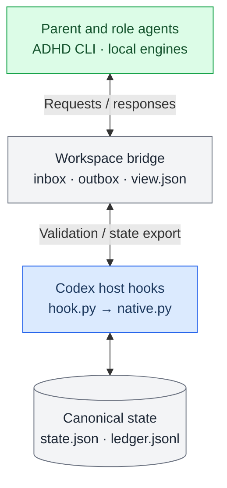
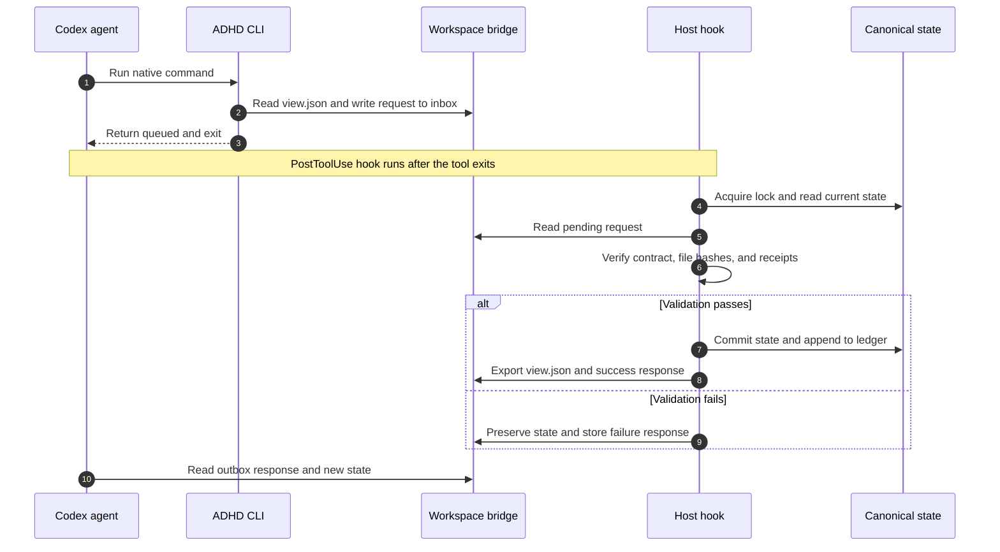
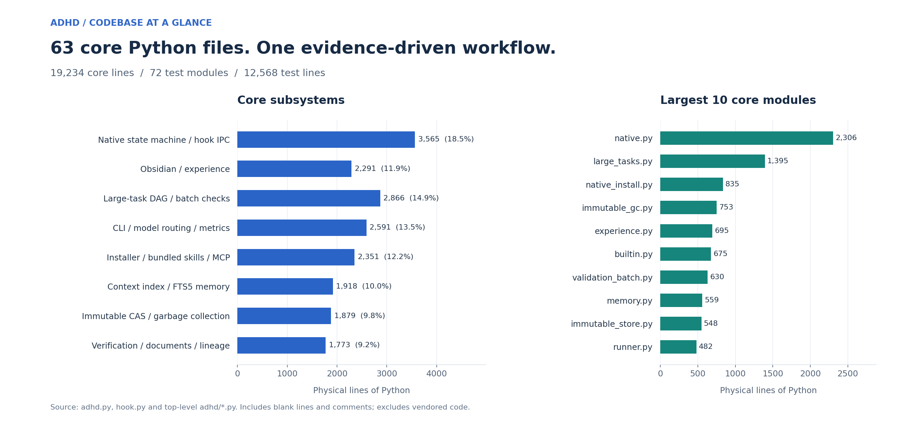
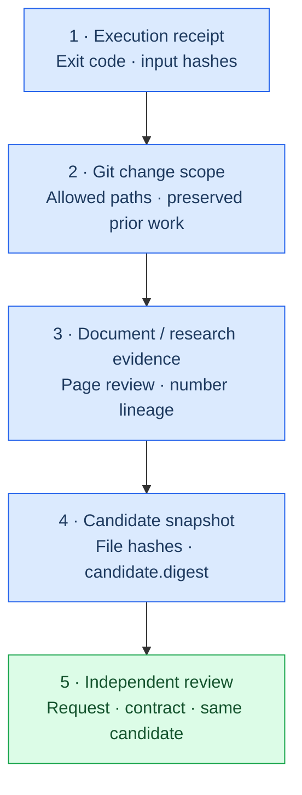
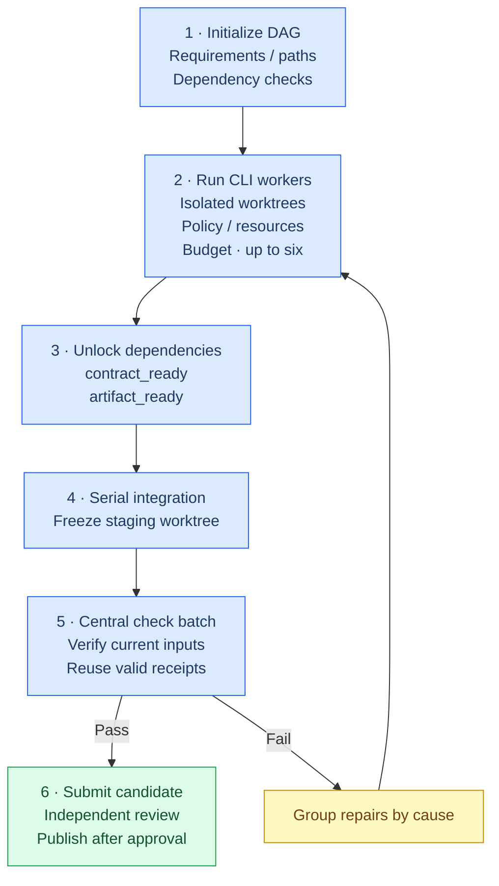
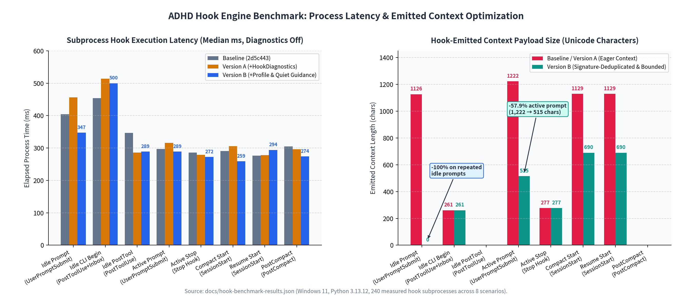
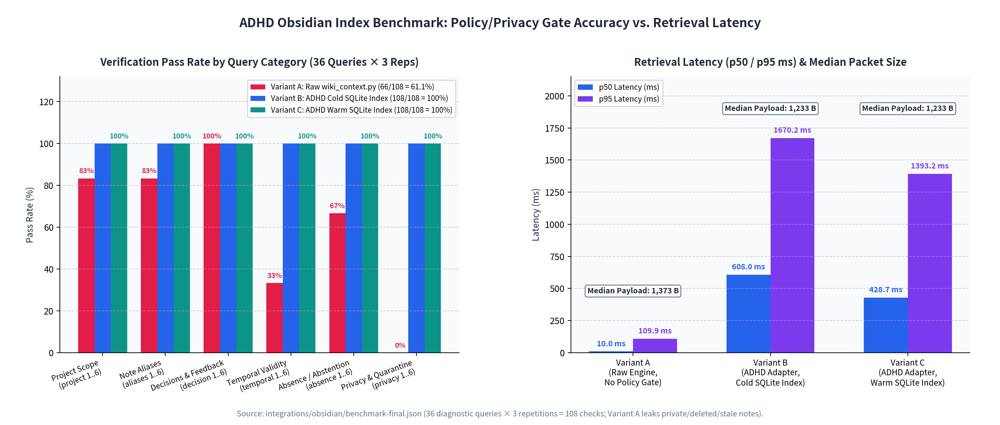

# ADHD — Autonomous Delegation Harness Director (v0.1.7)

[한국어](README.md) · [English](README_en.md) · [Quick start in Korean](README.ko.md)

> **A local orchestration harness for autonomous delegation and verification in Codex App and CLI**<br>
> Codex lifecycle hooks connect **requirements-based planning → bounded delegation → execution receipt verification → independent review** while preserving existing user authentication (`auth.json`), model choices, routers, plugins, and personal configuration (`config.toml`).

| Item | Specification (measured from this codebase) |
| :--- | :--- |
| **Package version** | `v0.1.7` ([adhd/__init__.py](adhd/__init__.py); state schema `v2`; installation record schema `v3`) |
| **Runtime requirements** | Python `3.11+` for source installation; the Windows x64 offline installer bundles the official embedded `Python 3.13.16` runtime |
| **Core engine size** | **63** Python source files (`adhd.py`, `hook.py`, `adhd/*.py`); **19,234 LOC** of core code |
| **Regression suite** | **72** test modules (`tests/test_*.py`); **12,568 LOC** covering more than 550 unit, subprocess, and packaging checks |
| **Agent roles** | **Six fixed roles** (`native/agents/*.toml`) across three model tiers: `gpt-6-sol`, `gpt-6-luna`, and `gpt-6-astra` |
| **Bundled skills and MCP** | **13** core/workflow skills (`skills/adhd*`), **50** public bundled skills (`bundled/skills/`), and **16** MCP recipes (`config/mcp-selection.json`) |
| **Vendored dependencies** | `filelock` v3.29.0 (Unlicense) and `tomlkit` (MIT), bundled as offline pure-Python dependencies ([adhd/dependencies.py](adhd/dependencies.py)) |
| **Licenses** | `Apache-2.0` ([LICENSE](LICENSE)); preserves the `MIT` notice for the upstream Raibit Harness v1.2 lineage ([LICENSE-RAIBIT-MIT](LICENSE-RAIBIT-MIT)) |

> System flow: Codex lifecycle hooks → ADHD native controller/task runner → verified artifacts and independent review.

## 1. Project overview and design principles

**ADHD (Autonomous Delegation Harness Director)** is a local orchestration harness designed to address problems that arise when AI agents handle complex coding, research, document, data analysis, and game development tasks: **premature claims of completion, missed requirements, indiscriminate file edits, endless failure loops, and context bloat**.

Five architectural invariants run through the codebase ([hook.py](hook.py), [adhd/native.py](adhd/native.py), [adhd/large_tasks.py](adhd/large_tasks.py), and [adhd/coding_scope.py](adhd/coding_scope.py)):

1. **Trust boundary between host hooks and the sandboxed CLI**
   * The Codex host executes [hook.py](hook.py), which reads at most `180,000 bytes` of event JSON from `stdin` and writes only control JSON to `stdout`. **It never directly runs model-supplied shell commands or Git subprocesses.**
   * Canonical state lives outside the workspace at `$CODEX_HOME/adhd/native/<SESSION_KEY>/state.json`. The workspace exposes `.adhd/bridge/<SESSION_KEY>/view.json` only as a read-only projection.
2. **One loop owner and one writer**
   * Only one execution owner (ADHD, OMX, or LazyCodex) controls a session's loop.
   * In an App session, only one implementation child (`adhd-implementer`) may hold the writer lease at a time ([adhd/leases.py](adhd/leases.py)). Parallel `large` jobs run only as up to six CLI worker processes in isolated Git worktrees, each with a lease generation.
3. **Pinned role hierarchy without silent model downgrades**
   * Planning, integration, implementation, and verification are pinned to `gpt-6-sol` (`effort="max"`); scouting and light extraction use `gpt-6-luna` (`effort="max"`, optionally `"low"`); difficult design advice uses `gpt-6-astra` (`effort="low"`, at most once per task). Account or router errors do not silently substitute a lower-tier model ([adhd/models.py](adhd/models.py)).
4. **Progress grounded in observed execution receipts**
   * A text summary or timestamp change does not count as progress. The `stagnation` counter resets only for an **execution receipt (`receipt.json`) bound to input file hashes** from [adhd/evidence.py](adhd/evidence.py), an increase in passed requirements, a decrease in failed tests, or a real target artifact hash change.
5. **Mandatory independent acceptance**
   * An author (the parent director or `adhd-implementer`) cannot mark their own work `complete`. The independent **`adhd-verifier`** checks every `candidate` snapshot in a read-only sandbox against the original prompts (`prompts`), contract hash (`contract_hash`), candidate digest (`candidate.digest`), and execution receipts. Only a `{"verdict": "approve"}` response allows the `SubagentStop` hook to move the task to `complete`.

## 2. System architecture and data flow

The host owns canonical state; agents submit requests through the workspace bridge. The diagram centers on that boundary. Later tables describe role configuration and verification rules.



### Asymmetric hook-to-sandbox IPC (Inbox / Outbox / View)

An agent running in the sandbox cannot directly modify the host's canonical `state.json`. Instead, `submit_request()` and `process_inbox()` in [adhd/native.py](adhd/native.py) perform state transitions through a **two-stage asynchronous commit protocol**:



## 3. Directory structure and the 63 core Python files

The repository contains entry points (`adhd.py`, `hook.py`), the core package (`adhd/`), pinned agent profiles (`native/agents/`), harness and bundled skills (`skills/`, `bundled/skills/`), schemas (`schemas/`), configuration catalogs (`config/`), build and install tools (`build/`), benchmark scripts (`scripts/`), and regression tests (`tests/`).

```text
ADHD/
├── adhd.py                         # Main CLI entry point (calls adhd.cli.main)
├── hook.py                         # Codex host hook entry point (stdin JSON -> adhd.native.handle_event)
├── install.ps1 / install.sh        # One-click upgrade scripts for Windows PowerShell and macOS/Linux
├── requirements-documents.txt      # Optional document rendering/editing dependencies (pypdf, python-docx, python-pptx, etc.)
├── adhd/                           # Core orchestration package (61 modules, 19,193 LOC)
│   ├── native.py                   # Host state machine, nine hook handlers, candidate/reviewer gate (2,306 LOC)
│   ├── large_tasks.py              # Large-task SQLite DAG queue, lease generations, Git worktree staging (1,395 LOC)
│   ├── native_install.py           # Transactional overlay installer, backup checks, atomic rollback (835 LOC)
│   ├── immutable_gc.py             # Closed-world garbage collector for the immutable CAS store (753 LOC)
│   ├── experience.py               # Selective experience candidates, feedback mapping, ledger recovery (695 LOC)
│   ├── builtin.py                  # 50 bundled skills and readiness/probe checks for 16 MCPs (675 LOC)
│   ├── validation_batch.py         # Central check batch, input-hash reuse, failure grouping (630 LOC)
│   ├── memory.py                   # Local SQLite FTS5 + Korean character bigrams + RRF memory (559 LOC)
│   ├── immutable_store.py          # SHA-256 content-addressed completion evidence and ZIP export (548 LOC)
│   ├── runner.py                   # Process-tree execution/termination, resource locks, legacy loop runner (482 LOC)
│   ├── context_index.py            # Python AST symbols and incremental SQLite code index (460 LOC)
│   ├── obsidian.py                 # Workspace-scoped Obsidian vault context retrieval (442 LOC)
│   ├── core.py                     # Atomic file I/O, SHA-256 hashing, path-traversal defense, shared utilities (433 LOC)
│   ├── obsidian_index.py           # Frontmatter parser, aliases/revisions/tombstones SQLite index (406 LOC)
│   ├── extensions.py               # External extension staging, immutable local pins, probes (405 LOC)
│   ├── evidence.py                 # Local-process execution receipts and host-tool observation (400 LOC)
│   ├── snapshot_reader.py          # Isolated immutable/dirty snapshot reads and writer handoff checks (399 LOC)
│   ├── experience_procedures.py    # Proposals and rollback for validated success procedures (389 LOC)
│   ├── context_search.py           # Combined code/memory/wiki location search and revision-bound reads (341 LOC)
│   ├── resource_metrics.py         # Process-tree CPU/memory/disk sampling and post-run observation (330 LOC)
│   ├── documents.py                # Office/PDF/HWP/HWPX inspection, text edits, page rendering (328 LOC)
│   ├── trial_registry.py           # All-Start experiment registry and preregistered rollout gate (316 LOC)
│   ├── context_session.py          # Per-actor/epoch context ledger and Markdown status export (304 LOC)
│   ├── experience_storage.py       # Wiki/evidence storage inventory, reference audit, archive restore (298 LOC)
│   ├── cli.py / extra_cli.py       # Parsers and dispatchers for 23 top-level CLI commands (570 LOC combined)
│   ├── coding_scope.py             # Git change-scope capture/audit/verification; hook-side Git-free checks (257 LOC)
│   ├── fts_migration.py            # Online migration to FTS5 external-content memory index (254 LOC)
│   ├── snapshots.py                # Streaming snapshots of artifacts and render bundles, including large files (247 LOC)
│   ├── loop_guard.py               # 12-slot failure-fingerprint ring, secret masking, stagnation steering (238 LOC)
│   ├── storage.py                  # Scan and safely prune unreferenced older managed releases (238 LOC)
│   ├── source_cache.py             # Reusable snapshots of pinned local Git commits/paths (217 LOC)
│   ├── large_execution.py          # Isolated Codex CLI worker execution and owned-path commits (207 LOC)
│   ├── provenance.py               # Lineage verification for research claims, source data, analysis scripts (198 LOC)
│   ├── install.py                  # Legacy install/uninstall and tree-hash verification (196 LOC)
│   ├── large_cli.py                # CLI parser for large/batch work and local publication (187 LOC)
│   ├── execution_decisions.py      # Authorized action records, denial classification, polling intervals (185 LOC)
│   ├── change_journal.py           # Owner-scoped conditional config.toml edits and journal recovery (167 LOC)
│   ├── intent.py                   # Version-bound add/replace/retract patches to active contracts (163 LOC)
│   ├── host_capabilities.py        # Hook normalization, host capabilities, thread goal tracking (161 LOC)
│   ├── gates.py                    # Plan shape, learning checks, document-contract gates (144 LOC)
│   ├── run_metrics.py              # Observed token/cost totals and paired experiment comparison (134 LOC)
│   ├── recovery.py                 # Eleven failure categories and recovery diagnoses (132 LOC)
│   ├── request_routing.py          # Four-way initial idle request routing (direct/simple/inspect/deep) (129 LOC)
│   ├── delivery_policy.py          # Preservation rules, deadline alerts, release/live delivery checks (111 LOC)
│   ├── large_native.py             # Read-only large-task approval adapter inside native hooks (110 LOC)
│   ├── evaluation.py               # Repeated evaluation with profile-specific personal-task fixtures (100 LOC)
│   ├── models.py                   # Sol/Luna/Astra policy, role routing, effort overrides (96 LOC)
│   ├── large_prompts.py            # Compact English worker packets preserving original excerpts (90 LOC)
│   ├── immutable_policy.py         # Workspace-owned immutable-policy.json authorization checks (89 LOC)
│   ├── leases.py                   # Workspace single-writer lease acquire/renew/release (81 LOC)
│   ├── windows_setup.py            # Offline Windows installer entry after bundle extraction (67 LOC)
│   ├── skill_router.py             # External skill_wiki.py first, local deterministic fallback (66 LOC)
│   ├── wiki.py                     # Safe ZIP scans and selective Markdown ingestion (61 LOC)
│   ├── maintenance_budget.py       # Synchronous CPU (10s) and I/O (512 MiB) budgets per maintenance task (58 LOC)
│   ├── review_calibration.py       # Reviewer accuracy against fixed calibration cases (47 LOC)
│   ├── completed_archive.py        # Explicit capture of text evidence from completed native runs (34 LOC)
│   ├── time_budget.py              # Optional wall-time limit checks (20 LOC)
│   ├── obsidian_assets/            # Obsidian bridge.py, log codec/archive, five templates, two Bases
│   └── vendor/smolagents_context.py# Long-output middle-truncation utility
├── native/agents/                  # TOML definitions for six native roles (planner, scout, light, architect, implementer, verifier)
├── skills/                         # 13 ADHD skills (adhd, adhd-native, adhd-goal, adhd-shape, etc.)
├── bundled/skills/                 # 50 license-verified public skill trees (OpenAI 30 + K-Dense 20)
├── config/                         # builtin-skills.json, mcp-selection.json, profile/policy examples
├── schemas/                        # Six JSON schemas (plan, work, review, large-task, native-delivery, wiki-packet)
├── build/                          # Package builder (package_adhd.py) and Windows C# launcher (launcher.cs)
├── scripts/                        # 11 hook, scope, delivery, time-budget, and Obsidian benchmark scripts
├── docs/                           # Nine design documents, release notes (0.1.4–0.1.7), measured benchmark JSON
├── third_party/                    # Vendored packages (filelock, tomlkit, spec-kit, superpowers) and licenses
└── tests/                          # 72 integration/regression test modules (12,568 LOC)
```



*Current source snapshot: 63 core Python files and 19,234 LOC; 72 test modules and 12,568 LOC. These use the same counting scope as the table below.*

### Subsystem size and responsibilities

| Subsystem | Included modules | LOC | Share | Main engineering responsibilities |
| :--- | :--- | ---: | ---: | :--- |
| **1. Native state machine and hook IPC** | `native.py`, `hook.py`, `intent.py`, `loop_guard.py`, `recovery.py`, `request_routing.py`, `host_capabilities.py`, `execution_decisions.py`, `delivery_policy.py`, `leases.py`, `time_budget.py`, `hook_diagnostics.py`, `__init__.py` | 3,565 | 18.5% | Handle nine Codex hook events; asynchronous `inbox`/`outbox` transitions; detect loop stagnation and steer strategy; enforce the single-writer lease |
| **2. Obsidian vault and experience engine** | `obsidian.py`, `obsidian_index.py`, `experience.py`, `experience_procedures.py`, `experience_storage.py`, `wiki.py` | 2,291 | 11.9% | Validate Markdown frontmatter, index SQLite cache, manage selective experience and feedback ledgers, adopt controller-validated procedures, archive evidence |
| **3. Large-task DAG and batch validation** | `large_tasks.py`, `validation_batch.py`, `snapshots.py`, `large_execution.py`, `large_cli.py`, `large_native.py`, `large_prompts.py` | 2,866 | 14.9% | Schedule work in a SQLite DAG, run up to six isolated Git-worktree CLI workers, stage serially, batch checks centrally, reuse matching input hashes |
| **4. CLI, model routing, and metrics** | `cli.py`, `extra_cli.py`, `core.py`, `runner.py`, `models.py`, `resource_metrics.py`, `trial_registry.py`, `run_metrics.py`, `evaluation.py`, `skill_router.py`, `maintenance_budget.py`, `adhd.py` | 2,591 | 13.5% | Expose 23 CLI commands, pin Sol/Luna/Astra models, measure process-tree resources, enforce experiment registry and maintenance budgets |
| **5. Installer, bundled skills, and MCP** | `native_install.py`, `builtin.py`, `extensions.py`, `install.py`, `change_journal.py`, `windows_setup.py`, `dependencies.py` | 2,351 | 12.2% | Install transactionally under `$CODEX_HOME` with atomic rollback, distribute 50 public skills, verify 16 MCP states/read probes, support offline Windows setup |
| **6. Context indexing and FTS5 memory** | `context_index.py`, `memory.py`, `context_search.py`, `context_session.py`, `fts_migration.py` | 1,918 | 10.0% | Index Python AST symbols; search Korean bigrams, SQLite FTS5, and RRF hybrid memory; track per-actor/epoch context handoffs |
| **7. Immutable CAS and garbage collection** | `immutable_store.py`, `immutable_gc.py`, `storage.py`, `source_cache.py`, `immutable_policy.py`, `completed_archive.py` | 1,879 | 9.8% | Store completed-run evidence in SHA-256 CAS; enforce policy-based access; prune unreferenced objects/releases after closed-world reference-closure validation |
| **8. Verification gates, documents, and provenance** | `evidence.py`, `documents.py`, `coding_scope.py`, `provenance.py`, `gates.py`, `review_calibration.py`, `snapshot_reader.py` | 1,773 | 9.2% | Issue execution receipts (`receipt.json`), audit Git change scope, verify Office/PDF/HWP page rendering, check research-number lineage |
| **Total (Core Python)** | **63 Python source files** | **19,234** | **100.0%** | **Verified alongside 72 test files (`12,568 LOC`), a 1:0.65 ratio** |

## 4. Seven core operating principles in the code

### Principle 1: Dispatch of nine lifecycle hooks and output budgets

The installer ([adhd/native_install.py](adhd/native_install.py), L481–490) registers nine hook groups in `$CODEX_HOME/hooks.json`. Every hook calls [hook.py](hook.py). Its [adhd/native.py](adhd/native.py) `handle_event()` acquires the per-session lock at `$CODEX_HOME/adhd/native/<SESSION>/state.lock` before processing an event.

| Hook event | Matcher | Timeout | Context limit (`additionalContextLimit`) | Behavior and security invariant in `adhd/native.py` |
| :--- | :--- | :---: | :---: | :--- |
| **`SessionStart`** | All session starts (`startup`, `resume`, `compact`, `clear`, `fork`) | 20s | `1200` | Records SHA-256 hashes of `session_helper_profiles`, `session_verifier_profile`, and `session_reader`; restores the current objective, profile, and unmet criteria after compaction/resumption |
| **`UserPromptSubmit`** | On user prompt | 20s | `1200` | Detects stop (`그만`/`stop`), resume (`재개`/`resume`), and goal (`/goal`, `$adhd-goal`) commands; calls `classify_request()` for initial routing; returns empty context when the same `guidance_signature` repeats |
| **`PreToolUse`** | `Agent\|spawn_agent` | 20s | `1200` | Checks time-budget expiry and blocks retries of the same denied host action (`matched_host_action`); `spawn_guard()` enforces role, model, quota, and single-writer rules |
| **`PostToolUse`** | `Bash\|exec\|wait\|exec_command\|write_stdin\|apply_patch\|update_plan\|mcp__.*` | 20s | `1200` | Observes host tool results (`observe_host_tool`), processes up to eight bridge `inbox/*.json` requests (`process_inbox`), and detects repeated failures of the same command (`observe_tool_loop()`) |
| **`SubagentStart`** | At child start | 20s | `1200` | `start_child()` proves child correlation through a reserved `tool_use_id` or matching `session_verifier_profile` hash, then creates a task packet with original excerpts in `.adhd/bridge/SESSION/packets/` |
| **`SubagentStop`** | At child exit | 20s | None | `stop_child()` marks the child finished and releases the lease after the final child in an interrupt/handoff; for **`adhd-verifier`**, a strict JSON verdict moves the task to `complete` or `revising` |
| **`PostCompact`** | Immediately after context compaction | 20s | None | Resets `view_hint_sig` and restores the current state summary to prevent lost context |
| **`Stop`** | On attempted turn end | 20s | None | Applies pending `inbox` requests, detects file changes after approval (`is_fresh` failure moves to `revising`), updates rounds/stagnation during active work, and returns `{"decision": "block", "reason": "[ADHD_CONTINUE:...]"}` to continue the loop |
| **`SessionEnd`** | On session end (including `Interrupt`) | 3s | None | During active work, calls `end_after_children(state, 'paused')`, preserving the writer lease until all running children finish |

* **1,200-character required-field priority (`context()` L1966–2073):** When constructing context guidance, the hook first includes recovery fields such as `ADHD Status=...`, `SESSION=...; view=...`, `Next: ...`, and time-budget information. It uses only the remaining characters (`1200 - len(text) - 1`) for extra explanation. This keeps a long workspace path or objective from truncating the next action in the middle ([docs/hook-followup-fixes.md](docs/hook-followup-fixes.md)).

### Principle 2: Initial request routing and native state transitions

When a user submits a prompt in `idle` state, `classify_request()` in [adhd/request_routing.py](adhd/request_routing.py) uses regular expressions and context rules to assign one of four initial paths. Small questions can then avoid the overhead of unnecessary planning and verification loops.

| Route (`path`) | Decision rule (`adhd/request_routing.py`) | Suggested profile | Native controller action |
| :--- | :--- | :---: | :--- |
| **`direct`** | Greetings (`_GREETING`), status questions (`_STATUS`), pure translation without external file references (`_TRANSLATION`), isolated word/sentence typo fixes (`_TYPO` + `_ISOLATED`), and general explanations without repository references (`_EXPLANATION` without `_REPO_REFERENCE`) | `simple` | **Skip `native begin`** and answer immediately without a durable plan or independent review loop; promote to `begin` if scope grows |
| **`simple`** | Small edit actions (`_SMALL_ACTION`) bounded to one file, function, or test (`_BOUNDED`) | `simple` | `native begin --profile simple`: optional `plan`, direct editing or delegation to at most one work child, and **mandatory final independent review (`adhd-verifier`)** |
| **`inspect`** | Unclear action scope; repository-dependent questions (`_REPO_REFERENCE`); sensitive keywords (`_SENSITIVE`, such as database, authentication, payment, deletion, deployment, security); translation/explanation paired with a follow-up action | `standard` | Briefly inspect relevant files and context, then run `native begin` if substantial work remains; the default `standard` profile requires a requirement-covered plan, automatic checks, and independent review |
| **`deep`** | Architecture redesign, migration, research, operational deployment, end-to-end systems, or security audits (`_DEEP`) | `deep` | `native begin --profile deep`: a detailed plan with `alternatives`, `risks`, and `preflight`; **fresh execution receipts (`deep_evidence`) covering every target artifact and deep review** |

* **Brief approval inheritance (`is_brief_approval`):** For a short approval such as `"ㅇㅇ 그렇게 해줘"`, `"진행해줘"`, or `"go ahead"`, the route and text of the preceding substantive request (`is_substantive_request_source`) become the `effective_prompt`.
* **User input during an active contract (`sync-intent` and [adhd/intent.py](adhd/intent.py)):** New messages enter `pending_turn_ids` and hold final review. The agent must classify each as `no_change` (a status question), `amend` (an incremental change to the existing contract's `criteria`, `artifacts`, `documents`, or `protected_inputs`, propagated to running children through `pending_context_deltas`), or `new_task` (archive the prior run and prepare a new contract).

```mermaid
stateDiagram-v2
    accTitle: Native task review lifecycle
    accDescr: Work progresses from a contract to a frozen candidate and independent review. Rejected or changed artifacts return to revision; interruption states preserve the contract.
    direction TB
    [*] --> idle
    idle --> working: native begin
    working --> reviewing: native candidate
    reviewing --> complete: Independent review approves
    reviewing --> revising: Rejection or validation failure
    revising --> working: Update plan or contract
    revising --> reviewing: Submit revised candidate
    complete --> revising: Post-approval file change
```



Interruption outcomes are distinguished as `paused`, `blocked`, `cancelled`, or `budget_exhausted`. If children are still running, the controller first waits in `interrupt_pending` and releases the lease after they finish. A `new_task` transition with active children passes through `handoff_pending` before archiving the prior run. The diagram shows representative paths; resuming an interrupted run requires a real user request.

### Principle 3: Three pinned model tiers and six governed agent roles

[adhd/models.py](adhd/models.py) and [native/agents/*.toml](native/agents/) define six agent roles, pinning each role to a model, reasoning effort (`model_reasoning_effort`), and sandbox permission (`sandbox_mode`).

| Agent role (`ROLES`) | Definition | Pinned model (`MODELS`) | Default effort | `role_effort` override | Sandbox mode | Main duty and `spawn_guard()` constraint |
| :--- | :--- | :---: | :---: | :---: | :---: | :--- |
| **`adhd-planner`** | `adhd-planner.toml` | `gpt-6-sol` | `max` | No (`max` fixed) | `read-only` | Reviews original inputs and coding discipline; prepares an execution plan with requirement coverage, alternatives, risks, and checks |
| **`adhd-scout`** | `adhd-scout.toml` | `gpt-6-luna` | `max` | Yes (`low` / `max`) | `read-only` | Collects narrow evidence and location pointers for assigned files/sources (recommended limit: 1,200 words) |
| **`adhd-light`** | `adhd-light.toml` | `gpt-6-luna` | `max` | Yes (`low` / `max`) | `read-only` | Helps with small fact extraction, formatting suggestions, and explanations; cannot spawn children or perform broad web research |
| **`adhd-architect`** | `adhd-architect.toml` | `gpt-6-astra` | `low` | No (`low` fixed) | `read-only` | Advises on one unresolved major design/hypothesis judgment after evidence collection (**at most one call per task; input brief `<= 8,000` characters; output target `<= 1,800` tokens**) |
| **`adhd-implementer`** | `adhd-implementer.toml` | `gpt-6-sol` | `max` | No (`max` fixed) | `workspace-write` | Implements code/artifacts within the approved plan and owned scope (**the App permits only one implementation child at a time**) |
| **`adhd-verifier`** | `adhd-verifier.toml` | `gpt-6-sol` | `max` | No (`max` fixed) | `read-only` | Final independent gate comparing original prompts, contract, real files, receipts, and rendered images against a fresh candidate snapshot (`is_fresh`) |

* **Quota and reserve protection (`DEFAULTS` in `adhd/native.py` L103):**
  * Up to `max_children = 3` children may run concurrently, with `max_total_children = 12` calls per task. At least `max_review_children = 3` slots are reserved for `adhd-verifier` and cannot be consumed by ordinary work children.
  * Resuming does not reset cumulative limits (`max_lifetime_children = 36`, `max_lifetime_rounds = 24`).
  * With explicit `--time-limit-seconds` and `--review-reserve-seconds`, the controller blocks new non-review children when the pre-end reserve (`reserve_seconds`, 20% by default and at most 300 seconds) begins (`spawn_guard()` L1648).

### Principle 4: Loop guard, stagnation detection, and strategy steering

[adhd/loop_guard.py](adhd/loop_guard.py) and `update_stagnation()` in [adhd/native.py](adhd/native.py) prevent repeated failing commands and file churn without meaningful progress.

1. **12-slot failure-fingerprint ring (`observe_tool_loop()`):**
   * Watches results from `Bash`, `exec`, `exec_command`, `apply_patch`, and `write_stdin`. A `SECRET_FLAG` regular expression first masks command-line arguments such as `--api-key`, `--token`, `--password`, and `--secret` as `[REDACTED]`.
   * Stores a SHA-256 digest of `[command_id, verified_failure_signature(output)]` in a ring buffer of size 12 (`RING_SIZE = 12`). A simple `rg` non-match (`exit_code == 1`) is excluded from failures.
   * The same fingerprint raises a Level 1 warning after **three** occurrences and Level 2 after **five**, prompting a changed hypothesis and the smallest discriminating failure check. Success (`exit_code == 0`) clears the warning.
2. **Separating progress from churn (`update_stagnation()`, `CHURN_GRACE = 3`):**
   * The `Stop` hook compares `progress_markers` after each round.
   * Counted progress: (1) a newly passed requirement (`requirement_pass`), (2) a completed plan step (`plan_step`), (3) fewer failed tests in a receipt, or (4) an actual byte-hash change to a declared target artifact before candidate submission. Artifact changes receive at most **three (`CHURN_GRACE`)** grace credits after the last verified outcome progress.
   * Without progress, `stagnation` rises; in ordinary `bounded` mode, reaching `max_stagnation = 3` safely ends the run as `budget_exhausted`.
3. **Multi-stage stagnation ladder in goal mode (`steer_if_stuck()` and `stuck.md`):**
   * Persistent runs started with `/goal` or `$adhd-goal` issue intervention messages at **rounds 3, 6, and 9 (Stages 1, 2, and 3)** instead of ending on stagnation.
   * The controller writes `failure_history`, repeated commands (`loop_notes`), and reviewer rejections (`review_findings`) to `.adhd/bridge/<SESSION>/stuck.md`. It sets `needs_replan = True`, blocking `candidate` submission until a new plan is submitted.
4. **Repeated-review Jaccard similarity (`repeated_review_rejection()`):**
   * When `adhd-verifier` rejects consecutive candidates, the controller compares the word sets in the previous and current findings using **Jaccard similarity (`len(old & current) / len(old | current) >= 0.6`)** and intersects mentioned file paths. Repeated reports of the same defect block another simple patch attempt and set `needs_replan = True` to require a strategy change.

### Principle 5: Five integrity gates

Five code-backed gates act in sequence from `native candidate` submission through final `SubagentStop` approval.



* **Hook-side zero-Git scope revalidation ([adhd/coding_scope.py](adhd/coding_scope.py)):**
  * The CLI's `coding-scope audit` invokes Git and writes `.adhd/scope-report.json` with `files` (a visible-file SHA-256 map), `changes` (changed paths), `excluded_paths`, `tree` (up to 20,000 inventoried files), and `git_metadata` (SHA-256 hashes of `.git/HEAD`, `.git/index`, `.git/packed-refs`, and the current branch ref file).
  * Later, host-hook `validate_report()` runs **no Git process**. Filesystem reads and SHA-256 comparisons alone detect added/deleted files, changed contents, or a covert `git commit`/`git reset` after the audit.

### Principle 6: SQLite DAG scheduler and central batch validation for large tasks

Large jobs divided into independent packages use `LargeTaskStore` in [adhd/large_tasks.py](adhd/large_tasks.py) and [adhd/validation_batch.py](adhd/validation_batch.py).



* **Conservative check reuse (`_reuse` in [adhd/validation_batch.py](adhd/validation_batch.py) L286–337):**
  * Given a `previous_report` during repair, the batch does not rerun every check automatically. It reuses a previous passing result only if (1) `run_id`, `contract_revision`, and `contract_hash` match; (2) the check is not `critical`, `external_state`, or `time_sensitive`; (3) `impact_complete: true` and `environment_complete: true` are declared; (4) no prerequisite check ran afresh this time; and (5) the check definition, executable hash, declared environment variables, and current byte hashes of every input (`subject_paths` + `dependency_paths` + `fixture_paths`) exactly match the previous passing receipt.

### Principle 7: Bounded context, Korean hybrid memory, Obsidian, and immutable CAS storage

The context and storage layers strengthened in v0.1.6–v0.1.7 combine **minimal necessary context transfer** with **strict resource budgets**:

| Engine / module | Storage path and format | Algorithm and behavior | Hardware / resource budget |
| :--- | :--- | :--- | :--- |
| **AST code indexer**<br/>([adhd/context_index.py](adhd/context_index.py)) | `$CODEX_HOME/adhd/context-index-*.sqlite3` | Uses Python `ast.NodeVisitor` to extract class/function/symbol definitions and reference line ranges into an incremental SQLite index. Every actual `context read` checks the current source-file hash | SQLite cache `8 MiB`; parser LRU cache `16 MiB`; single-file parse limit `16 MiB`; streaming buffer `1 MiB` |
| **Actor/epoch context session**<br/>([adhd/context_session.py](adhd/context_session.py)) | `.adhd/context-session/*.json`, `.adhd/context-status.md` | For repeat reads by the same actor (such as `parent`) in the same `epoch`, file revision, and line range, returns a compact `reference` instead of the source text to save prompt tokens | Default retrieval limit of six cards / 6,500 characters; updates `.adhd/context-status.md` only when state changes |
| **Korean hybrid memory**<br/>([adhd/memory.py](adhd/memory.py), [adhd/fts_migration.py](adhd/fts_migration.py)) | `$CODEX_HOME/adhd/memory-v2.sqlite3` | Combines **SQLite FTS5 (`unicode61`), Korean syllable bigrams (`{w[i:i+2]}`), and Reciprocal Rank Fusion (RRF)** for mixed Korean/English queries without a GPU or external embedding API. Automatically blocks secret-like patterns (`SECRET`) | SQLite cache `8 MiB`; supports online external-content FTS migration (`fts_migration.proposal/cutover`) |
| **Obsidian wiki index**<br/>([adhd/obsidian.py](adhd/obsidian.py), [adhd/obsidian_index.py](adhd/obsidian_index.py)) | `<project>/.adhd/obsidian-index.sqlite3` | Strict frontmatter (`_strict_metadata`), `read_roots`/`write_roots` and `allowed_privacy` checks, duplicate-ID quarantine (`duplicate-id-quarantined`), and deleted-note tombstones. Every packet carries `authority: "source_data"` | Per-note limit `4 MiB`; default packet budget 6,500 characters; only selected experiences become candidates in `.adhd/experience/ledger.json` |
| **Immutable CAS and GC**<br/>([adhd/immutable_store.py](adhd/immutable_store.py), [adhd/immutable_gc.py](adhd/immutable_gc.py)) | `$CODEX_HOME/adhd/immutable-v2/` | Stores verified completed-run evidence as SHA-256 CAS objects. Checks `.adhd/immutable-policy.json` on every access. **Closed-world GC** takes locks in `state.lock → lease.guard → store.lock` order, then quarantines and removes only objects outside the reference closure | Per-object limit `64 MiB`; up to 64 registered roots per workspace; per-maintenance-task `CPU 10s / I/O 512 MiB` (`MaintenanceBudget`) |

## 5. Measured benchmarks and performance analysis

This analysis uses measurements recorded in [docs/hook-benchmark-results.json](docs/hook-benchmark-results.json), [docs/hook-lazy-imports.md](docs/hook-lazy-imports.md), and [integrations/obsidian/benchmark-final.json](integrations/obsidian/benchmark-final.json).

### 5.1 Codex hook subprocess latency and emitted context



*These are saved Windows benchmark results. Context character counts are not token usage, and these measurements do not establish a whole-task speedup or cost reduction.*

The Windows 11 benchmark (`Python 3.13.12`, `filelock 3.29.0`) measured eight scenarios across three versions (`Baseline`, `Version A: added HookDiagnostics instrumentation`, and `Version B: profile-based quiet context guidance and restoration`), two diagnostic modes, and five repeats: **240 hook subprocess executions** in total.

| Scenario | Codex hook event | Baseline median / p95 (ms) | Version A median / p95 (ms) | Version B median / p95 (ms) | Emitted context (Before → B) | Context reduction and main change |
| :--- | :--- | ---: | ---: | ---: | ---: | :--- |
| **`idle_prompt`** | `UserPromptSubmit` (repeated while idle) | 404.0 / 572.2 | 456.1 / 645.1 | **347.4 / 420.8** | `1,126 → 0 chars` | **-100.0%** (omits repeated guidance when `guidance_signature` matches) |
| **`idle_cli_begin`** | `PostToolUse` (process `begin` inbox) | 453.6 / 2050.0 | 513.9 / 912.2 | **500.1 / 780.8** | `261 → 261 chars` | **Unchanged** (still emits the `begin` acknowledgement and initial guidance) |
| **`idle_post_tool`** | `PostToolUse` (ordinary tool exit) | 346.4 / 366.5 | 285.5 / 389.5 | **288.8 / 334.8** | `0 → 0 chars` | **Unchanged** (no unnecessary output; `stdout` is the four bytes `{}`) |
| **`active_prompt`** | `UserPromptSubmit` (active contract) | 296.9 / 335.4 | 315.6 / 321.0 | **289.2 / 317.7** | `1,222 → 515 chars` | **-57.9%** (focuses on state, profile, and next action) |
| **`active_stop`** | `Stop` (continuation loop control) | 286.0 / 396.5 | 278.9 / 425.0 | **272.2 / 289.6** | `277 → 277 chars` | **Unchanged** (preserves `[ADHD_CONTINUE:...]` block reason) |
| **`active_compact_start`** | `SessionStart` (`source="compact"`) | 290.3 / 337.5 | 305.4 / 322.9 | **259.3 / 291.8** | `1,129 → 690 chars` | **-38.9%** (restores the key objective, unmet criteria, and next action) |
| **`active_resume_start`** | `SessionStart` (`source="resume"`) | 276.3 / 396.6 | 278.2 / 331.9 | **294.1 / 340.6** | `1,129 → 690 chars` | **-38.9%** (restores the preserved contract summary on resume) |
| **`active_post_compact`** | `PostCompact` | 305.1 / 319.4 | 296.3 / 313.7 | **274.0 / 474.7** | `0 → 0 chars` | **Unchanged** (`SessionStart(compact)` handles restoration, so this emits nothing) |

* **Internal phase timing (with `HookDiagnostics` enabled):** Of the approximately `270–350 ms` total subprocess time, starting Python and importing `adhd.native` (`native_import`, approximately `125–165 ms`) take most of it. The actual hook stages (`stdin_parse` ~`0.05 ms`, `lock_wait` ~`0.65 ms`, `state_read` ~`0.50 ms`, `event_dispatch` ~`1.5–4.5 ms`, `persist` ~`4.2 ms`) total **under 10 ms**.
* **Hook lazy import experiment ([docs/hook-lazy-imports.md](docs/hook-lazy-imports.md)):** Delaying imports of `snapshots`, `coding_scope`, and `provenance` until their first use reduced `native_import` for `active_prompt` from `160.6 ms` to `138.8 ms` in 1,320 samples. Inbox handling at the first snapshot/provenance check grew slightly due to deferred import costs (`15.2 ms → 17.9 ms` and `50.9 ms → 59.4 ms`, respectively).

### 5.2 Obsidian context and privacy/revision gate benchmark



*These fixture results come from 36 diagnostic queries repeated three times. They do not guarantee typical user performance or accuracy across all documents.*

The measurement in [integrations/obsidian/benchmark-final.json](integrations/obsidian/benchmark-final.json) compares six categories (`project`, `aliases`, `decision`, `temporal`, `absence`, `privacy`) with six questions each: **36 diagnostic queries (24 development and 12 held-out) × three repeats = 108 retrievals**. Variant A is the existing standalone `wiki_context.py`; Variant B uses the ADHD adapter with a cold SQLite index; Variant C uses the ADHD adapter with a warm SQLite index.

| Metric | Variant A (standalone `wiki_context.py`) | Variant B (ADHD adapter, cold index) | Variant C (ADHD adapter, warm index) | Engineering interpretation |
| :--- | :---: | :---: | :---: | :--- |
| **Overall pass rate (`passed / checks`)** | `66 / 108` (**61.1%**) | `108 / 108` (**100.0%**) | `108 / 108` (**100.0%**) | Variant A failed 42 checks because it did not filter privacy, validity windows, ambiguous aliases, and deleted notes |
| **Category: `decision`** | 100.0% (18/18) | **100.0%** (18/18) | **100.0%** (18/18) | All three approaches retrieved decision and feedback notes correctly |
| **Category: `project` / `aliases`** | 83.3% (15/18) | **100.0%** (18/18) | **100.0%** (18/18) | Variant A mixed in another project's incident (`project-6`) and missed a duplicate-alias collision (`aliases-5`) |
| **Category: `temporal` (validity)** | 33.3% (6/18) | **100.0%** (18/18) | **100.0%** (18/18) | The ADHD index compares `valid_from`/`valid_until` and `supersedes` to exclude expired decisions |
| **Category: `absence` (abstention)** | 66.7% (12/18) | **100.0%** (18/18) | **100.0%** (18/18) | When evidence is absent, it abstains with `no-results` / `section-not-found` instead of returning a false note |
| **Category: `privacy` (security/isolation)** | **0.0%** (0/18) | **100.0%** (18/18) | **100.0%** (18/18) | ADHD blocked disallowed `private` notes, `retrieval: excluded` notes, broken frontmatter, duplicate IDs, and deleted tombstoned notes in all fixture checks |
| **Latency (`p50` / `p95` ms)** | `10.0 ms` / `109.9 ms` | `608.0 ms` / `1,670.2 ms` | **`428.7 ms` / `1,393.2 ms`** | Each retrieval checks current file hashes, policy, and revision; warm-index reuse lowers p50 by **29.5%** from the cold index |
| **Median response packet size (`median_bytes`)** | `1,373 B` | **`1,233 B`** | **`1,233 B`** | Filtering irrelevant notes reduces the packet and returns precise revision pointers |

## 6. Workflow skills and bundled ecosystem

### 6.1 ADHD core and workflow skills (13)

ADHD uses a **modular skill architecture**: call a skill at the point of need and hand its reasoning to the existing execution owner, rather than forcing every task through a fixed pipeline ([skills/adhd-native/references/skill-handoff.md](skills/adhd-native/references/skill-handoff.md)).

| Skill invocation | Path | Type | Role and native-protocol integration |
| :--- | :--- | :---: | :--- |
| **`$adhd-native`** | [skills/adhd-native/SKILL.md](skills/adhd-native/SKILL.md) | Core | Overall map for the hook-based planning, delegation, and verification protocol (links to `protocol-quickstart.md`) |
| **`$adhd`** | [skills/adhd/SKILL.md](skills/adhd/SKILL.md) | Core | Determines the single loop owner (ADHD / OMX / LazyCodex) and routes task modes (`coding`/`research`/`study`/`report`/`game`) |
| **`$adhd-memory`** | [skills/adhd-memory/SKILL.md](skills/adhd-memory/SKILL.md) | Core | Rules for project-scoped local memory (`memory-v2.sqlite3`) and Obsidian wiki context retrieval/recording |
| **`$adhd-documents`** | [skills/adhd-documents/SKILL.md](skills/adhd-documents/SKILL.md) | Core | Protected original snapshots and full-page render review for Office (`.docx`, `.pptx`, `.xlsx`), PDF, and Hangul (`.hwp`, `.hwpx`) documents |
| **`$adhd-extensions`** | [skills/adhd-extensions/SKILL.md](skills/adhd-extensions/SKILL.md) | Core | Staging (`stage`), immutable-pin checks, read-only probes (`probe`), and rollback for external skill/MCP extensions |
| **`$adhd-goal`** | [skills/adhd-goal/SKILL.md](skills/adhd-goal/SKILL.md) | Workflow | Entry via `/goal` or `$adhd-goal`; removes implicit round/time/stagnation cutoffs and loops through implementation, checking, and repair until independent acceptance |
| **`$adhd-shape`** | [skills/adhd-shape/SKILL.md](skills/adhd-shape/SKILL.md) | Workflow | Shapes a vague idea into a problem, first complete scope, constraints, and testable completion criteria (`criteria`) |
| **`$adhd-challenge`** | [skills/adhd-challenge/SKILL.md](skills/adhd-challenge/SKILL.md) | Workflow | Surfaces major untested assumptions and failure risks in a plan and designs the smallest discriminating checks |
| **`$adhd-decide`** | [skills/adhd-decide/SKILL.md](skills/adhd-decide/SKILL.md) | Workflow | Compares real alternatives and records grounds, tradeoffs, and revisit conditions |
| **`$adhd-steer`** | [skills/adhd-steer/SKILL.md](skills/adhd-steer/SKILL.md) | Workflow | Classifies feedback during a run (`no_change`/`amend`/`new_task`) and updates the contract/child packets with `native sync-intent` |
| **`$adhd-unblock`** | [skills/adhd-unblock/SKILL.md](skills/adhd-unblock/SKILL.md) | Workflow | Diagnoses repeated failures or blockers from real receipt logs (`diagnose recovery`), changes the hypothesis, and runs bounded recovery |
| **`$adhd-optimize`** | [skills/adhd-optimize/SKILL.md](skills/adhd-optimize/SKILL.md) | Workflow | Improves code performance, resources, or structure while preserving external behavior and checking before/after regressions |
| **`$adhd-retro`** | [skills/adhd-retro/SKILL.md](skills/adhd-retro/SKILL.md) | Workflow | Draws corrections and verified lessons from actual outcomes and feedback (long-term memory storage requires explicit user consent) |

### 6.2 Fifty bundled public skills (`bundled/skills/` and `config/builtin-skills.json`)

`adhd.py upgrade` or `adhd.py builtin apply` installs the complete trees of **50 public skills** whose licenses and per-file SHA-256 hashes have been verified. If a user skill folder of the same name exists, the user folder is preserved and the release copy remains available as a fallback.

| Source repository (pinned commit) | License | Count | Included skills (`bundled/skills/*`) |
| :--- | :---: | :---: | :--- |
| **[openai/skills](https://github.com/openai/skills)**<br/>(`49f948faa925`) | `Apache-2.0` (25)<br/>`MIT` (5) | **30** | `aspnet-core`, `chatgpt-apps`, `cli-creator`, `define-goal`, `gh-address-comments`, `gh-fix-ci`, `hatch-pet`, `jupyter-notebook`, `linear`, `migrate-to-codex`, `netlify-deploy`, `notion-knowledge-capture`, `notion-meeting-intelligence`, `notion-research-documentation`, `notion-spec-to-implementation`, `openai-docs`, `pdf`, `playwright`, `playwright-interactive`, `render-deploy`, `screenshot`, `security-best-practices`, `security-ownership-map`, `security-threat-model`, `sentry`, `speech`, `transcribe`, `vercel-deploy`, `winui-app`, `yeet` |
| **[K-Dense-AI/scientific-agent-skills](https://github.com/K-Dense-AI/scientific-agent-skills)**<br/>(`154988403bb5`) | `MIT` (20) | **20** | `astropy`, `biopython`, `dask`, `experimental-design`, `exploratory-data-analysis`, `literature-review`, `matplotlib`, `networkx`, `polars`, `scientific-brainstorming`, `scientific-critical-thinking`, `scientific-visualization`, `scientific-writing`, `scikit-learn`, `seaborn`, `statistical-analysis`, `statistical-power`, `statsmodels`, `sympy`, `uncertainty-and-units` |

### 6.3 Sixteen MCP recipes and five-stage readiness checks ([adhd/builtin.py](adhd/builtin.py))

The 16 MCP connection recipes in [config/mcp-selection.json](config/mcp-selection.json) are not considered usable (`usable: true`) merely because they are registered. `adhd.py builtin status` and `adhd.py builtin probe` track **`registered` → `dependencies_ready` → `auth_integration_verified` → `connected` → `read_verified` (`usable = true`)** separately. Probe evidence is bound to recipe, executable, and credential digests and expires after **one hour (3,600 seconds)**.

| Initial activation class | MCP key (`key`) | ID | Transport / invocation | Purpose and prerequisites (`config/mcp-selection.json`) |
| :--- | :--- | :---: | :--- | :--- |
| **Anonymous remote endpoint**<br/>(enabled by default) | `firecrawl` | M04 | HTTP (`mcp.firecrawl.dev`) | Structured collection from multiple web pages and site discovery |
| **Anonymous remote endpoint**<br/>(enabled by default) | `exa` | M05 | HTTP (`mcp.exa.ai`) | Semantic web-source discovery (search-provider candidate 1) |
| **Anonymous remote endpoint**<br/>(enabled by default) | `openai-docs` | M15 | HTTP (`developers.openai.com`) | Read-only search/retrieval of official OpenAI and Codex documentation |
| **Local launcher**<br/>(enabled after executable/runtime checks) | `aside` | M02 | `aside mcp` (stdio) | Automation and inspection in a logged-in browser (official Aside CLI required) |
| **Local launcher**<br/>(enabled after executable/runtime checks) | `chrome-devtools` | M03 | `npx chrome-devtools-mcp@1.10.1` | Chrome console, network, and performance diagnostics (Chrome + Node 20.19+/22.12+ required) |
| **Local launcher**<br/>(enabled after executable/runtime checks) | `arxiv` | M08 | `uvx arxiv-mcp-server==0.7.3` | arXiv paper discovery, download, metadata retrieval (`uvx` required) |
| **Local launcher**<br/>(enabled after executable/runtime checks) | `godot` | M10 | `npx @coding-solo/godot-mcp@0.1.1` | Godot projects, scenes, logs (`godot` executable + Node 18+ required) |
| **Local launcher**<br/>(enabled after executable/runtime checks) | `drawio` | M12 | `npx @drawio/mcp@1.6.3` | Editable system and pipeline diagrams (Node 18+ required) |
| **Authentication required**<br/>(disabled by default; token/OAuth needed) | `tavily` | M06 | HTTP (`TAVILY_API_KEY`) | Web search, page extraction, crawling (environment-variable credential required) |
| **Authentication required**<br/>(disabled by default; token/OAuth needed) | `brave-search` | M07 | `npx @brave/brave-search-mcp-server@2.1.4` | Web and news search (`BRAVE_API_KEY` required) |
| **Authentication required**<br/>(disabled by default; token/OAuth needed) | `jupyter` | M09 | `uvx jupyter-mcp-server==2.2.3` | Live Jupyter kernels and notebooks (`JUPYTER_URL`, `JUPYTER_TOKEN`) |
| **Authentication required**<br/>(disabled by default; token/OAuth needed) | `figma` | M13 | HTTP (`mcp.figma.com`, OAuth) | Design context and UI implementation (`--oauth-token-env` probe supported) |
| **Authentication required**<br/>(disabled by default; token/OAuth needed) | `sentry` | M14 | HTTP (`mcp.sentry.dev`, OAuth) | Post-deployment error and trace diagnosis (OAuth required) |
| **Authentication required**<br/>(disabled by default; token/OAuth needed) | `notion` | M16 | HTTP (`mcp.notion.com`, OAuth) | Read/write research records, pages, databases (OAuth required) |
| **Separate engine integration required**<br/>(disabled by default; probe required) | `blender` | M01 | `uvx mcp-for-blender==2.1.3` | 3D assets, scenes, rendering (`blender` program and add-on integration probe required) |
| **Separate engine integration required**<br/>(disabled by default; probe required) | `unity` | M11 | `uvx mcpforunityserver==10.2.0` | Unity editor, scenes, scripts (`unity` editor-package integration probe required) |

## 7. Installation, upgrades, rollback, and CLI reference

### 7.1 Installation and transactional upgrades

Before changing files, the ADHD installer ([adhd/native_install.py](adhd/native_install.py)) records `$CODEX_HOME/adhd/native-install-recovery.json` and backups under `$CODEX_HOME/adhd/backups/native-<stamp>/`. If concurrent edits or I/O errors occur during installation, it quarantines changed files and restores the originals byte for byte.

**Windows (PowerShell or offline installer)**
```powershell
# Option 1: Run the offline installer with embedded Python 3.13.16 (no administrator rights or network required)
.\ADHD-Setup-v0.1.7-windows-x64.exe

# Option 2: Diagnose and upgrade from a source checkout
py -3 .\adhd.py doctor
py -3 .\adhd.py upgrade

# If needed, safely roll back managed files only (refuses to overwrite subsequent user edits)
py -3 .\adhd.py rollback-native
```

**macOS / Linux (Bash)**
```bash
python3 adhd.py doctor
python3 adhd.py upgrade
# Alternatively, run ./install.sh
```

* **Hook trust approval (`/hooks`):** The installer does not alter or bypass Codex's hook trust state. After upgrading, open a new Codex App/CLI session, inspect newly registered commands under `/hooks`, and approve trust there.
* **Pruning unreferenced older releases ([adhd/storage.py](adhd/storage.py)):**
  ```bash
  # Preview older releases eligible for cleanup (read-only)
  python3 -m adhd.storage scan

  # Apply deletion while protecting the current release, at least two recent rollback releases by default, and every session-referenced release
  python3 -m adhd.storage prune --apply --keep-releases 2
  ```

### 7.2 Reference for all 23 top-level `adhd.py` commands

The complete CLI interface is implemented in [adhd/cli.py](adhd/cli.py), [adhd/extra_cli.py](adhd/extra_cli.py), and [adhd/large_cli.py](adhd/large_cli.py).

| Command (`adhd.py <cmd>`) | Main subactions (`action` / `operation`) | Main caller | Description and key options |
| :--- | :--- | :---: | :--- |
| **`doctor`** | `--codex-home PATH` | User / CI | Audits installation integrity, hook registration, role-profile drift (`role_effort_drift`), bundled skills, and MCP status |
| **`install` / `upgrade`** | `--codex-home`, `--compact`, `--migrate-existing-roles` | User | Deploys an immutable release under `$CODEX_HOME/adhd/releases/` and applies nine hooks, six roles, skills, and MCP settings |
| **`rollback-native` / `uninstall`** | `--codex-home PATH` | User | Checks backup hashes and subsequent user edits, then restores managed overlays to their pre-installation state |
| **`builtin`** | `apply`, `status`, `probe`, `enable`, `rollback` | User / agent | Applies the 50-skill public bundle and 16 MCP recipes individually; supports read-only probes (`--consent --probe-file`) and activation |
| **`request-route`** | `"PROMPT"`, `--previous`, `--active-contract` | Agent / diagnostics | Inspects four-way initial prompt routing (`direct`/`simple`/`inspect`/`deep`) without starting execution |
| **`native`** | `begin`, `goal`, `plan`, `checkpoint`, `candidate`, `sync-intent`, `attach-large`, `attach-batch`, `pause`, `blocked`, `status`, `record-action`, `authorize-action`, `action-decision`, `action-outcome`, `read-observation`, `wait-observation` | Agent | Queues requests (`inbox/`) from the sandbox to the host native state machine; supports `--profile`, `--time-limit-seconds`, and `--review-reserve-seconds` |
| **`check`** | `--workspace`, `--spec-file CHECK.json` | Agent | Executes an explicit `argv` array without shell interpretation and creates `receipt.json` bound to input/output hashes |
| **`coding-scope`** | `capture`, `audit`, `verify` | Agent / verifier | Captures allowed Git checkout paths (`--allow`) and existing changes, audits out-of-scope edits, and revalidates via receipts |
| **`large`** | `init`, `status`, `events`, `dispatch`, `run-workers`, `interface`, `submit`, `stage`, `freeze`, `validate`, `repairs`, `cancel`, `confirm-cancel`, `amend`, `reconcile`, `publish` | Agent | Manages a large-task SQLite DAG, runs isolated Git-worktree CLI workers, integrates and freezes serially, validates, and publishes locally |
| **`batch`** | `run`, `diagnose`, `verify`, `repairs`, `build-decision` | Agent | Runs a central post-assembly check batch, diagnoses check-plan cost, and decides whether unchanged check receipts can be reused |
| **`context`** | `locate`, `read`, `handoff`, `trace`, `status` | Agent | Searches code/memory/wiki locations (`locate`), reads with revision/epoch bindings (`read`), creates compaction handoff packets (`handoff`), and exports Markdown status |
| **`memory`** | `put`, `recall`, `forget`, `resolve`, `stats` | Agent | Stores/retrieves local SQLite FTS5 + Korean bigram + RRF memory; `recall` also returns active wiki context |
| **`wiki`** | `scan`, `import`, `configure`, `context`, `project`, `read`, `forget`, `record`, `record-completion`, `feedback`, `review`, `apply`, `usage`, `usage-record`, `procedure`, `storage`, `template`, `open-link` | Agent / user | Configures an Obsidian vault, retrieves scoped context, records/reviews/applies experience candidates, provisions templates/Bases, archives/restores logs |
| **`objects`** | `capture`, `read`, `export`, `restore`, `forget`, `audit`, `gc`, `apply`, `recover` | Agent / user | Captures completed-run evidence in immutable CAS (`immutable-v2`), exports/restores standalone ZIPs, and uses two-stage (`gc` → `apply`) garbage collection |
| **`snapshot`** | `prepare`, `read`, `claim-writer`, `capabilities` | Agent | Creates isolated snapshots of immutable commits or dirty working trees; reads with hash/line bindings; hands off the writer after generation checks |
| **`doc`** | `inspect`, `edit`, `edit-hwp`, `render`, `capabilities` | Agent | Inspects structure, edits text, and renders page images (`render.json`) for `.docx`, `.pptx`, `.xlsx`, `.pdf`, `.hwp`, and `.hwpx` |
| **`provenance`** | `verify MANIFEST --workspace PATH` | Agent | Verifies lineage and numerical agreement from raw research data through Python (`.py`) analysis scripts and result files to report claims |
| **`diagnose`** | `capabilities`, `recovery`, `manifest`, `calibration` | Agent | Inventories host capabilities, proposes recovery from failed receipts, suggests check inputs via static AST, and measures reviewer calibration |
| **`experiment`** | `start`, `finish`, `usable`, `summary`, `preregister`, `compare` | Agent / researcher | All-Start experiment registry that records failures, interruptions, and timeouts; evaluates preregistered rollout gates |
| **`metrics`** | `summarize`, `compare` | Agent / researcher | Summarizes observed token/call use (preserving missing fields as `null`, avoiding duplicate/child double counts) and compares paired experiments |
| **`route` / `skills` / `recall`** | `"QUERY"`, `--configure-wiki-router PATH` | Agent | Connects an external `skill_wiki.py` router, searches skills through a local deterministic fallback (`skills`), and retrieves validated procedure recipes (`recall`) |
| **`eval`** | `--out PATH`, `--profile simple\|standard\|deep` | Developer / CI | Repeats evaluations of selected execution-profile intensity against representative personal-task fixtures |
| **`run` / `resume` / `status` / `stop`** | `GOAL`, `RUN_ID`, `--mode`, `--iterations` | User | Optional legacy CLI batch-loop controller run directly in a terminal without host hooks |

## 8. Running tests and local audits

Contracts, state machines, hook dispatch, snapshots, garbage collection, and installation integrity in a source checkout can be checked locally without an external network or paid API calls.

```bash
# 1. Run all 72 unit and subprocess regression modules (550+ test cases)
python3 -m unittest discover -s tests -q

# 2. Run the read-only local installation audit test
python3 -m unittest scripts.test_audit_local_install -q

# 3. Check bytecode compilation and CLI help
python3 -m compileall -q adhd tests scripts
python3 adhd.py --help
```

## 9. Privacy boundary and license notices

* **Personal data and credentials:** This repository and its release packages contain harness source, schemas, license-checked public skill bundles, and default configuration recipes only. Do not commit personal `config.toml`, `auth.json`, `hooks.json`, `.adhd/` execution ledgers, generated evidence logs, or private Obsidian notes to Git; `.gitignore` excludes them by default.
* **Honest measurement:** If host-observed model token usage or cost is unavailable, it remains `null` (`unknown`) instead of being presented as `0` or an estimate. Fixture microbenchmarks are not claims about production token savings or end-to-end speedups.
* **Licenses:**
  * Top-level repository code: **Apache License 2.0** ([LICENSE](LICENSE)).
  * Inherited Raibit Harness v1.2 glue code and documentation: **MIT License** ([LICENSE-RAIBIT-MIT](LICENSE-RAIBIT-MIT), [ADHD_PROVENANCE.md](ADHD_PROVENANCE.md)).
  * Vendored third-party libraries and bundled skills retain their original licenses (`filelock` Unlicense, `tomlkit` MIT, `spec-kit` MIT, `superpowers` MIT, OpenAI Skills Apache-2.0/MIT, K-Dense Scientific Agent Skills MIT), recorded in [THIRD_PARTY_NOTICES.md](THIRD_PARTY_NOTICES.md) and [research/REUSE_MANIFEST.json](research/REUSE_MANIFEST.json).
